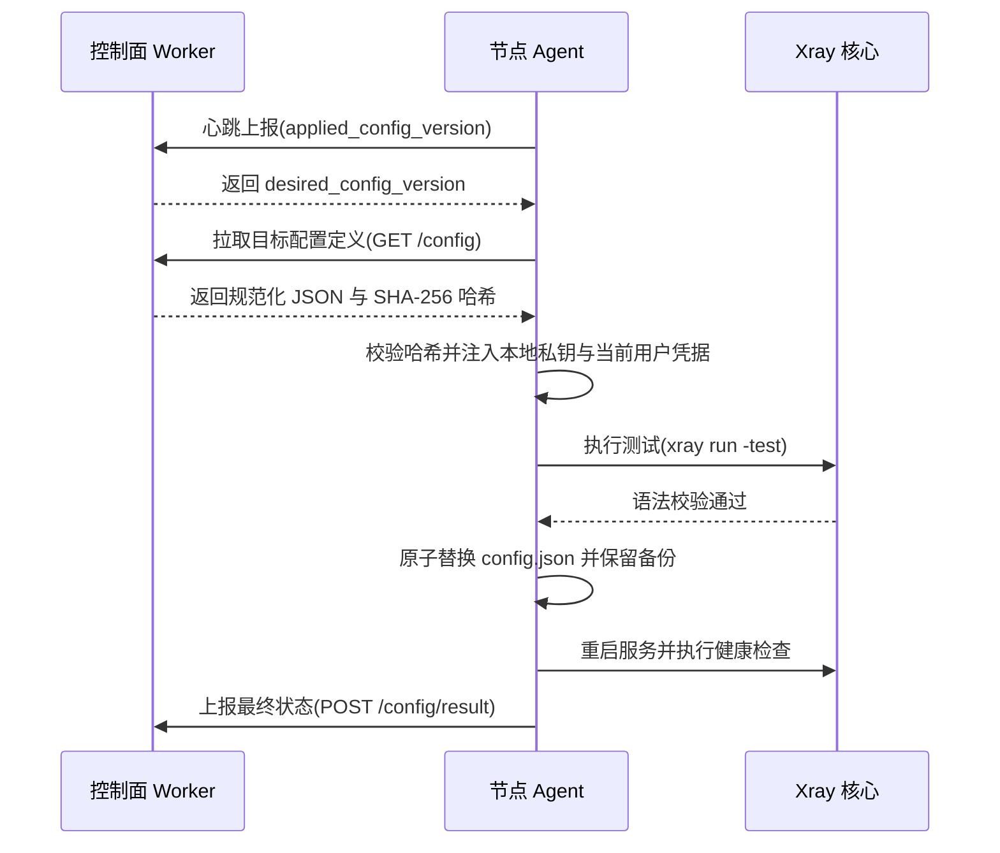

# 节点 Agent 架构与运行规范

Agent 作为独立静态 Go 二进制运行在节点（Debian 12/13）上，由 systemd 托管。Agent 仅通过出站 HTTPS 与控制面通信，并通过环回 gRPC 与本地 Xray-core 交互。安装与分发流程详见 [deployment.md](deployment.md)，指标采样与入账算法详见 [traffic.md](traffic.md)。

## 1. 运行模型与设计准则

- 单向通信：Agent 主动向控制面发起出站 HTTPS 请求，不对公网开放任何监听端口。
- 本地状态隔离：采用嵌入式 BoltDB 维护计数器采样基线、离线发送队列及版本状态，保障节点重启后数据连续。
- 私钥本地驻留：REALITY 私钥生成后永久驻留在节点本地，控制面仅保存公钥与入站配置定义。
- 变更最小化影响：优先通过 gRPC 执行客户端账号热更新；仅在热更新失败或接收到全局配置变更时触发进程安全重启。

## 2. 运行时配置项

配置文件默认位于 `/etc/zako-agent/config.yaml`，核心参数如下：

| 配置项 | 说明 | 默认值 |
| --- | --- | --- |
| `control_plane_url` | 控制面服务 HTTPS 根地址 | 必填 |
| `node_id` | 当前节点在控制面的唯一标识符 | 必填 |
| `agent_token_file` | 存放节点认证 Bearer Token 的文件路径 | `/etc/zako-agent/token` |
| `state_path` | 本地 BoltDB 状态库路径 | `/var/lib/zako-agent/state.db` |
| `users_path` | 本地已生效凭据快照文件路径 | `/var/lib/zako-agent/users.json` |
| `xray_config_path` | Xray 核心运行配置文件路径 | `/etc/xray/config.json` |
| `xray_binary_path` | Xray 可执行文件路径 | `/usr/local/bin/xray` |
| `reality_private_key_path` | 本地 REALITY 私钥存放路径 | `/etc/xray/reality.key` |
| `xray_api_address` | Xray 环回 gRPC 监听地址 | `127.0.0.1:10085` |
| `xray_inbound_tag` | 承载业务代理流量的入站 Tag | `vless-reality` |
| `heartbeat_interval` | 默认心跳周期（服务端响应可动态调整） | `5m` |
| `collector.sample_interval` | Xray 统计采样间隔 | `30s` |
| `collector.report_interval` | 流量增量出站结算间隔 | `15m` |

## 3. 用户凭据同步与热更新

### 3.1 版本通知与增量拉取

1. 控制面在凭据产生变更（用户增删、状态改变、额度超限或节点授权变动）时递增全局版本号 `users_ver`。
2. Agent 在心跳上报的响应中获取期望版本号 `desired_users_version` 并触发同步循环。
3. 同步模块使用已生效版本号作为 `If-None-Match` 标头向控制面发起 `GET /api/v1/agent/users` 请求。若版本一致，服务端返回 `304 Not Modified`，终止本轮处理。
4. 响应包含新凭据列表时，数据进入差异比对与生效阶段。

### 3.2 差集应用与降级回退

1. 差集计算：对比期望凭据列表与本地 `users.json` 记录，梳理出新增凭据集与待移除凭据集。凭据 UUID 变动转换为先删除后添加。
2. 运行时热更新：调用 Xray `HandlerService.AlterInbound` 接口，依次执行 `RemoveUser` 与 `AddUser` 指令。
3. 快照更新：热更新成功后，将最新用户集合原子写入 `users.json`，并持久化已生效版本号 `users_version`。
4. 降级回退：若热更新接口调用失败，Agent 自动切换至安全重启模式：
   - 将最新凭据与本地私钥合入完整配置模板。
   - 调用 `xray run -test -config` 进行配置语法与完整性校验。
   - 校验通过后原子替换 `/etc/xray/config.json`。
   - 调用 `systemctl restart xray.service` 重启服务。
   - 检查 StatsService 健康状态；若重启或健康检查失败，立即使用备份配置回滚并重新启动。
5. 并发保护：凭据同步与配置应用全程在 Agent 内部全局互斥锁保护下执行，同步期间产生的新触发信号自动合并为一次后续执行。

## 4. 远程配置下发与状态机

控制面支持下发不可变 Xray 全局配置定义，由 Agent 在本地编排合入与安全应用。

### 4.1 配置下发流程

### 4.2 状态转换与回滚策略

Agent 内部状态机按以下顺序流转：
`IDLE → DOWNLOADING → VERIFYING → RENDERING → TESTING → APPLYING → OBSERVING → APPLIED / FAILED`。

- 内容完整性：配置下载后首先比对控制面提供的 SHA-256 哈希，哈希失配立即终止流程。
- 凭据装配：配置定义中只包含通用网络、协议、策略与路由参数；Agent 本地负责读取 `reality.key` 与 `users.json` 注入入站块。
- 失败自愈：在配置切换前保留已知健康的旧配置文件。测试未通过、重启超时或观察期健康检查异常时，系统自动复原旧配置并再次重启服务。
- 幂等上报：无论执行成功或失败，Agent 均向控制面上报带版本标识的结构化结果。重复上报或已废弃旧版本的结果不会覆盖服务端较新的状态。

## 5. 节点安全权限模型

Agent 遵循最小特权原则运行在受限环境内：

- 运行身份：以独立的非特权系统用户 `zako-agent` 运行，启用 `NoNewPrivileges=true`，无 root 提权权限。
- 目录访问控制：
  - `/etc/xray` 目录所有权设为 `root:zako-agent`、权限 `0770`，允许 Agent 执行临时文件写入与原子替换（rename）。
  - `/etc/xray/config.json` 权限为 `0640`，属组为 `zako-agent`。
  - `/etc/xray/reality.key` 权限设为 `0600`，所有者为 `zako-agent`。
  - 运行时凭据 `/var/lib/zako-agent/users.json` 权限设为 `0600`。
- 服务管理授权：通过专用 polkit 规则（`/etc/polkit-1/rules.d/50-zako-agent-xray.rules`）仅授予 `zako-agent` 用户针对 `xray.service` 执行 `restart` 操作的权限。
