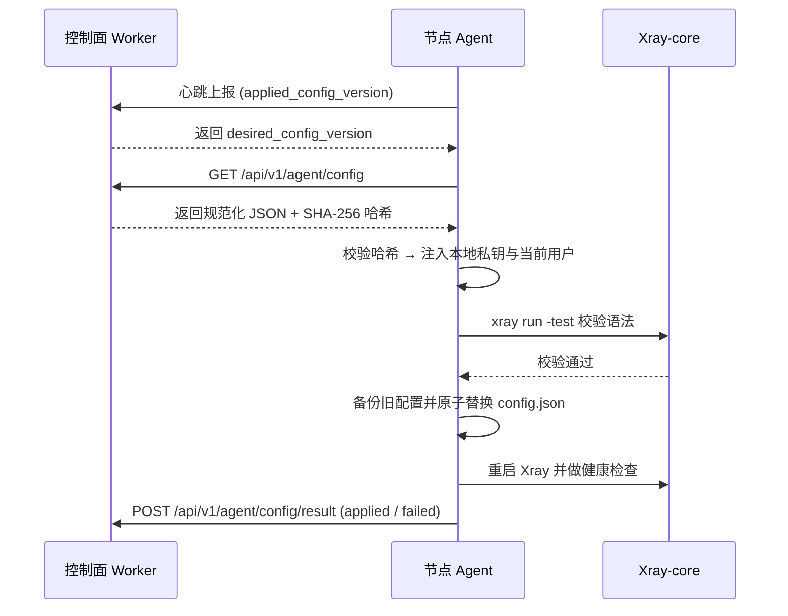

# 节点 Agent 工作原理

Agent 是跑在节点（Debian 12/13）上的独立 Go 二进制，由 `systemd` 托管。它只做两件事：**向控制面报平安/报流量**，以及**按控制面的指令更新本地 Xray 用户和配置**。

安装和上线步骤见 [deployment.md](deployment.md)，流量采样细节见 [traffic.md](traffic.md)。

---

## 1. 运行原则

- **只出不进**：Agent 只主动向控制面发 HTTPS 请求，不在节点上开任何公网监听端口；和 Xray 的 gRPC 通信只走 `127.0.0.1`。
- **私钥不出节点**：REALITY 私钥在安装时生成并留在 `/etc/xray/reality.key`，控制面只存公钥，永远拿不到私钥。
- **本地有账本**：采样基线、未发出去的流量报表、当前版本号都存在 BoltDB（`/var/lib/zako-agent/state.db`），节点重启不会丢账。
- **能热更新就不重启**：增删用户优先走 Xray gRPC 热更新，不断掉现有代理连接；只有热更新失败或整份配置改了才重启 Xray。

---

## 2. 常用路径与配置项

主配置文件默认在 `/etc/zako-agent/config.yaml`：

| 配置项 | 作用 | 默认值 |
| --- | --- | --- |
| `control_plane_url` | 控制面域名 | 必填 |
| `node_id` | 节点 ID | 必填 |
| `agent_token_file` | 节点认证 Token 文件 | `/etc/zako-agent/token` |
| `state_path` | BoltDB 本地状态库 | `/var/lib/zako-agent/state.db` |
| `users_path` | 上次成功生效的用户快照 | `/var/lib/zako-agent/users.json` |
| `xray_config_path` | Xray 配置文件（安装时发现已有配置则沿用该路径） | `/etc/xray/config.json` |
| `xray_binary_path` | Xray 可执行文件 | `/usr/local/bin/xray` |
| `reality_private_key_path` | 本地 REALITY 私钥 | `/etc/xray/reality.key` |
| `xray_api_address` | Xray gRPC 地址 | `127.0.0.1:10085` |
| `xray_inbound_tag` | 初始热更新入站 Tag（运行时按配置文件刷新全部受管入站及协议） | `vless-reality` |
| `heartbeat_interval` | 心跳间隔（服务端可动态下发覆盖） | `5m` |
| `collector.sample_interval` | 采集 Xray 流量间隔 | `30s` |
| `collector.report_interval` | 上报流量间隔 | `15m` |

---

## 3. 用户名单怎么同步（热更新与回退）

1. **发现变化**：控制面每次新增有效用户、修改用户状态、配额超限或到期，都会把全局版本号 `users_ver` 加 1。Agent 心跳时看到服务端返回的 `users_ver` 和自己手里不一样，就触发一次同步。
2. **省流拉取**：Agent 带上本地版本号作为 `If-None-Match` 请求 `GET /api/v1/agent/users`。如果版本其实没变，服务端直接返回 `304 Not Modified`。
3. **算差集并热更新**：对比新名单和本地 `users.json`，算出要新增、删除的用户（凭据变了就先删后加），调用 Xray gRPC `HandlerService.AlterInbound`（`RemoveUser` / `AddUser`）动态修改，然后原子更新 `users.json` 和版本号。每次同步前都会从当前配置文档重新读取受管入站列表，按每个入站的协议编码账号：VLESS/VMess 用 UUID，Trojan/Shadowsocks 用同一个凭据当密码，Shadowsocks 还要带上入站的加密方式。
4. **万一热更新失败（安全回退）**：
   如果 gRPC 调用失败，Agent 会自动切到“改文件 + 重启”模式：
   - 把新用户列表和本地私钥拼进完整的 Xray 配置，按各入站的协议写入受管入站（REALITY 私钥只补进 VLESS 入站）；
   - 先跑 `xray run -test -config` 确认语法没问题；
   - 原子替换 `/etc/xray/config.json` 并执行 `systemctl restart xray.service`；
   - 检查 `StatsService` 是否健康；如果重启失败或健康检查没过，立刻还原旧配置再重启一次。

> 整个同步和改配置过程都受全局互斥锁保护，同步期间如果又来了新触发，会合并成一次后续执行，不会并发打架。

---

## 4. 远程下发 Xray 配置

除了增删用户，管理员还可以在面板给节点下发新的 Xray 全局配置版本（只包含网络、路由、策略等通用 JSON，不含私钥和用户）。

Agent 内部按以下状态流转：`IDLE → DOWNLOADING → VERIFYING → RENDERING → TESTING → APPLYING → OBSERVING → APPLIED / FAILED`：

- **防篡改**：下载完先比对 SHA-256 哈希，对不上直接中止，不会往 Xray 里塞。
- **防失联**：替换前会留一份已知健康的旧配置备份。不管是 `xray run -test` 报错、重启超时，还是重启后观察期健康检查失败，都会自动还原旧配置并把错误信息报回面板。
- **结果幂等**：同一版本无论成功还是失败，都会带着版本号上报；旧版本的延迟结果不会覆盖控制面较新的状态。
- **受管入站必须带 Tag**：控制面按 Agent 的判定规则（协议 + 传输 + TLS）校验，受管入站缺 Tag 直接以 `422` 拒绝，因为 `HandlerService` 只能按 Tag 定位入站；Agent 不接管的入站不受此限制，原样保留。

---

## 5. 接管已有 Xray 配置

安装时 `zako-agent init` 读取节点已有的 Xray/V2Ray 配置；存在则沿用该文件，不存在时写入内置默认模板。

- 面板管理四类 Xray 入站：VLESS + REALITY（TCP）、VMess、Trojan 和 Shadowsocks。注册时按协议把端口与传输参数上报（VLESS 还上报 REALITY 公钥、Short ID 和 Fingerprint），面板据此自动创建 Endpoint。一次注册最多上报 16 个端点，超出的入站继续服务但不受面板管理。
- 无法用面板参数表达清楚的入站保持原样、不参与渲染：例如 VMess 的 REALITY/XTLS 传输、Trojan 没有 TLS SNI、Shadowsocks-2022 方法、以及 kcp 等面板不渲染的传输。这样即使节点上已有手工维护的同类入站，也不会被覆盖。
- Hysteria2 不是 Xray 协议，Agent 不接管也不参与用户同步；它的接入端点由管理员在后台手工创建。
- 已有配置没有任何受管入站时，会在未被占用的端口追加一个默认 VLESS + REALITY 入站，其余配置不变。
- 已有配置缺少 `api`、`stats`、Level 0 统计或 API 路由规则时只补缺失项，不覆盖已有值；这样接管后流量采集和用户热更新可以直接工作。
- 接管已有配置时保留节点原有的入站客户端。这些邮箱不在面板授权名单里，同步时通过 `HandlerService.RemoveUser` 在对应入站上就地撤销，不需要重启 Xray；只在部分入站出现的邮箱不会被当成错误。
- 热更新会按当前配置文件里的全部受管入站（Tag + 协议）逐个执行；任何一步失败都回退到重启并重写完整配置。

## 6. 节点权限隔离（最小特权）

Agent 不以 `root` 运行，而是用专用低权限用户 `zako-agent` 启动（`NoNewPrivileges=true`）：

- 配置目录属主为 `root:zako-agent`（权限 `0770`），允许 Agent 通过写临时文件 + rename 原子替换 `config.json`（`0640`）。安装脚本会接管 `/etc/xray`、`/usr/local/etc/xray`、`/etc/v2ray`、`/usr/local/etc/v2ray` 中最先找到的那个配置文件，因此这四个目录都在 systemd 单元的 `ReadWritePaths` 里，`ProtectSystem=strict` 才不会把接管后的路径变成只读。
- 私钥 `/etc/xray/reality.key` 和用户快照 `/var/lib/zako-agent/users.json` 权限都是 `0600`，仅 `zako-agent` 可读。
- 重启 Xray 不靠 `sudo`，而是通过一条专用 polkit 规则（`/etc/polkit-1/rules.d/50-zako-agent-xray.rules`），只允许 `zako-agent` 执行 `systemctl restart xray.service`。
- 远程自卸载同样通过该 polkit 规则授权：收到控制面 `uninstall` 指令后，Agent 向 `/api/v1/agent/uninstall` 回传确认，再触发以 `root` 运行的 `zako-agent-uninstall.service` 完成系统目录、systemd 单元、polkit 规则与服务账号的清理。
- **Agent 自动更新（权限隔离 + 失败回滚）**：管理员通过 `POST /api/v1/admin/nodes/:nodeId/agent-update` 指定目标版本后，控制面在心跳响应中下发 `self_update` 指令。低权限 `zako-agent` 从同源 `/dl/agent/` 下载 `SHA256SUMS` 与对应架构归档、校验哈希、解压并执行 `--version` 预检，写入 `/var/lib/zako-agent/update/pending.json` 后通过 polkit 启动以 `root` 运行的 `zako-agent-update.service`（`zako-agent apply-update`）。提权单元备份旧二进制为 `.bak`、原子替换并重启 `zako-agent.service`，在观察期内校验服务存活；若启动失败则自动还原 `.bak` 并重启旧版本，同时通过 `/api/v1/agent/update/result` 回传状态并在 BoltDB 中抑制同一失败版本的重复尝试。

> 节点上排查问题时，主要看 `journalctl -u zako-agent -f` 和 `journalctl -u xray -f`。
