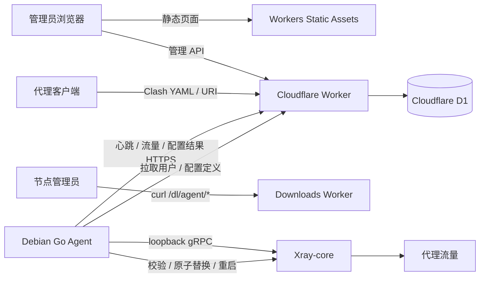

# 系统架构与核心概念

Zako Panel 由三部分组成：**控制面**（Cloudflare Worker + D1）、**管理后台**（Vue 3 静态页面）和**节点端**（Debian 上的 Go Agent）。
控制面只负责管配置、算账和发订阅，**不转发代理流量，不运行 Xray，也不主动去连节点**——所有节点状态和流量都靠节点上的 Agent 主动连上来汇报。

---

## 1. 先理清 6 个核心概念

第一次看代码或数据库时，最容易混淆的是“节点/端口”和“用户/订阅”。它们的关系可以这样理解：

```text
节点 (Node) ──< 接入端点 (Endpoint)
   │
   │  授权关联 (Node Client: xray_email + vless_uuid)
   ▼
订阅用户 (Subscriber) ──< 订阅链接 (Subscription) ──> 订阅档案 (Profile)
```

- **Node（节点）**：一台装了 Xray 和 Agent 的服务器。它有一把专属的 `agent_token` 用来和面板通信。
- **Endpoint（接入端点）**：节点对外提供代理服务的公网入口（域名/IP、端口、协议参数），协议支持 VLESS + REALITY、VMess、Trojan、Shadowsocks 与 Hysteria2。一台机器可以挂多个端口或域名，所以拆成了 `1 个 Node 对多个 Endpoint`；安装时从节点已有的 Xray 配置识别并自动创建，Hysteria2 端点由管理员手工创建。
- **Subscriber（订阅用户）**：真正在用代理的人。流量限额、月度用量、到期时间、是否启用，全部挂在人身上。
- **Node Client（节点凭据）**：管理员把某个用户授权给某个节点时，系统会为这对“用户-节点”生成一对固定的 `xray_email`（形如 `u_<ULID>`）和 `vless_uuid`。同一节点下的多个 Endpoint 共用这一对凭据：`vless_uuid` 在 VLESS、VMess 里当 UUID，在 Trojan、Shadowsocks、Hysteria2 里直接当密码。
- **Profile（订阅档案）**：决定订阅长什么样——选哪些节点（全部还是指定几个）、是不是只下发在线节点、Clash 的基础配置、代理组和分流规则怎么写。
- **Subscription（订阅链接）**：把某个 `Subscriber` 和某个 `Profile` 绑在一起生成的访问 Token（对应 URL `/sub/{token}`）。一个人可以有多个不同 Profile 的订阅链接，轮换或撤销某条链接不会影响其他人。

### 四条主线怎么串起来

1. **装节点**：管理员在面板生成一次性注册 Token → 节点跑一键脚本安装 Xray 和 Agent，识别并接管已有的 Xray 配置（没有配置时写入默认模板），只把 REALITY 公钥、传输参数和接入端点报给面板完成注册。
2. **授权用户**：管理员创建用户、授权节点 → 面板把全局版本号 `users_ver` 加 1 → Agent 下次心跳发现版本号变了，就来拉最新名单，通过 gRPC 热更新塞进本地 Xray。
3. **用户拉订阅**：客户端请求 `/sub/{token}/clash.yaml` → 面板校验用户没过期、没超额 → 把档案里选的节点和用户有权限的节点取交集，去掉离线/停用的节点 → 现场拼出 YAML 返回。
4. **收流量**：Agent 每 30 秒看一眼 Xray 计数器，每 15 分钟把增量按自然小时拆好，连同心跳一起发给面板 → 面板按 `report_id` 幂等记账并累加到用户当月用量。

---

## 2. 边界与容量目标

### 2.1 不做什么

为了把复杂度和成本压在 Cloudflare 免费额度内，以下功能**明确不做**：

- 多租户计费结算与自动支付
- 外部订阅转换服务
- WebSocket 长连接或面板主动向节点发起连接
- 实时硬限速（超额/到期采用“软限制”：停发新订阅并从节点移除凭据，已建立的连接等它自然断开）
- 任意远程 Shell 执行（远程下发配置只支持结构化 JSON）
- 历史版本 Agent 二进制归档与分钟级原始流量留存

### 2.2 设计规模

| 指标 | 设计目标 | 免费额度下建议上限 |
| --- | --- | --- |
| 节点数 | 20 | 100 |
| 订阅用户数 | 50 | 50 |
| 活跃“用户-节点”组合数 | 50 | 100 |
| 单节点活跃用户上限 | 20 | 20 |
| 心跳间隔 / 流量上报间隔 | 300 秒 / 900 秒 | 心跳 60–900 秒 / 上报 300–3600 秒 |
| 流量数据保留 | 90 天小时桶 / 30 天上报凭证 | 同左 |

系统开销主要取决于**活跃“用户-节点”组合数**（每次上报要写几张聚合表）。规模变大时，拉长上报间隔或升级 Workers 付费版即可。

---

## 3. 总体结构



只有 `/api/*` 和 `/sub/*` 会进 Worker 跑逻辑；前端静态页和 `/dl/*` 安装包直接由 Cloudflare 边缘静态资源返回，不消耗 Worker 计算时间。

---

## 4. 关键设计取舍

| 关注点 | 选了什么方案 | 为什么这么选 |
| --- | --- | --- |
| 工程组织 | Monorepo | Worker、Web、Agent 和 OpenAPI 契约放一起，改接口不容易漏 |
| 管理端鉴权 | Cloudflare Access JWT | 直接用 Access 校验好的邮箱当管理员身份，省掉密码哈希 CPU 消耗和独立管理员表 |
| Agent 鉴权 | `node_id.secret` Bearer Token | 数据库只存 SHA-256 哈希；每台节点独立凭证，不影响其他节点 |
| Agent 分发 | 独立静态 Downloads Worker | 下载安装包走 CDN 静态分发，不扣主 Worker 的请求和 CPU 额度 |
| 心跳与流量 | 合并在同一个上报接口 | 减少请求次数；每次上报顺便把状态和用量一起提交 |
| 流量防重 | 客户端 `report_id` + 载荷哈希 | 网络超时重试不会重复算流量；同 ID 但内容变了直接报 `409` |
| 流量查询 | 小时桶 + 全站桶 + 周期汇总表 | 看趋势图不用跨全表扫，检查用户超额只需读一行记录 |
| 节点状态 | 查询时根据最后心跳时间实时算 | 不用定时任务扫表改 `online/offline`，省下大量 D1 写入 |
| 用户下发 | 全局版本号 `users_ver` + 差集热更新 | 平时只在 Xray 内存里增删改用户，不断掉现有连接 |
| 配置下发 | 不可变配置版本 + SHA-256 校验 | REALITY 私钥永远留在节点本地；新配置测试失败自动回退旧配置 |

---

## 5. 代码分层与扩展方式

### 5.1 Worker 分层（`apps/worker/src/`）

- `routes/`：解析请求参数、校验格式、组装 HTTP 响应。
- `services/`：核心业务规则（节点筛选、配置发布、版本号递增、流量入账等）。
- `repositories/`：所有 D1 SQL 语句和批处理事务都放这里，不往外漏。
- `protocols/`：各代理协议的参数校验和配置转换，通过注册表统一接入。
- `renderers/`：把筛选后的节点列表渲染成 Clash.Meta YAML 或通用 URI。
- `middleware/`：Access JWT 校验、Agent Token 校验、统一错误处理与日志脱敏。
- `lib/`：纯函数工具（哈希、ULID、周期计算、状态判断）。

### 5.2 前端结构（`apps/web/src/`）

管理后台包含仪表盘（Overview）、节点管理与详情、订阅档案、订阅链接、用户管理与详情、流量分析等页面，采用以下分层：

- `domain/`：纯函数业务计算（流量单位换算、时间窗口切分、状态文案），不依赖 Vue。
- `i18n/`：中英文双语字典与响应式语言切换（默认按浏览器语言自动匹配，支持手动切换并本地记忆）。
- `composables/`：通用交互逻辑封装（请求加载、提交状态、弹窗、轮询）。
- `components/`：业务复用组件（Endpoint 表单、节点授权矩阵、流量图表）。

### 5.3 怎么扩展新功能

- **加新协议**：实现一个新的 `ProtocolAdapter`（定义参数校验 + Clash/URI 渲染）并注册进 `protocols/` 注册表；需要节点接管的协议还要加进 `AGENT_PROTOCOLS`，并在 Agent 侧补上入站识别与客户端渲染。
- **加新订阅格式**：复用已筛选好的节点列表 DTO，在 `renderers/` 下新增一个渲染器。
- **加新节点监控指标**：Heartbeat 请求体支持可选字段，控制面在对应 service 中消化即可。
- **加新管理功能**：先改 `packages/contracts/openapi.yaml` 并生成类型，再按 `migration → repository → service → route → web` 顺序补齐。
