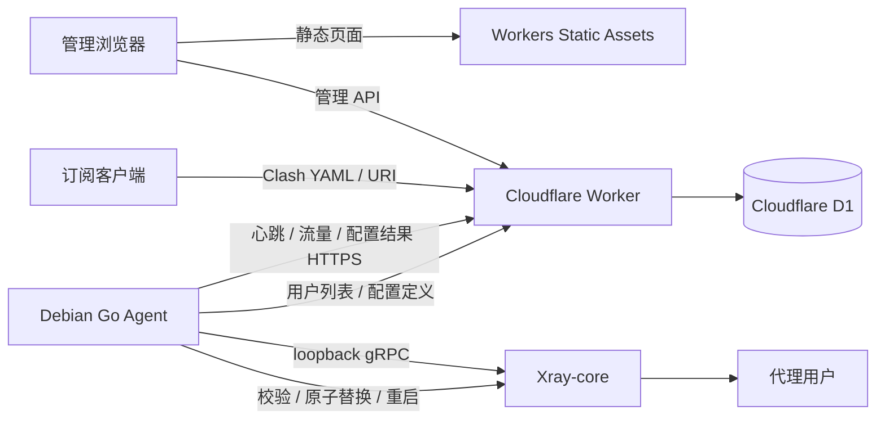

# Zako Panel 系统架构

Zako Panel 由控制面（Cloudflare Worker + D1）、管理界面（Vue SPA）与节点侧 Go Agent 组成。Worker 不转发代理流量，不执行 Xray，不主动连接节点。

本文件描述跨模块的目标、决策与边界。项目定位与开发命令见 [README](../README.md)；子系统细节见 [api.md](api.md)、[database.md](database.md)、[traffic.md](traffic.md)、[subscription.md](subscription.md)、[agent.md](agent.md) 与 [config-delivery.md](config-delivery.md)。

## 1. 目标与范围

### 1.1 阶段划分

| 阶段 | 功能 |
| --- | --- |
| P0 | 节点与默认订阅档案、VLESS + REALITY、Clash.Meta YAML / 通用 URI、规则分发、Agent 心跳与流量上报、幂等入账、节点与客户端流量统计 |
| P1 | 订阅用户、管理员角色、节点授权、独立订阅令牌、流量额度与到期、令牌轮换与撤销、用户集合同步、Xray 热更新、系统指标 |
| P2 | Xray 配置版本化、远程发布、校验、原子切换、失败回滚、配置历史与 diff |

交付顺序与验收标准见 [roadmap.md](roadmap.md)。

### 1.2 已确认约束

- P0 只支持 VLESS + REALITY，传输为 TCP，流控为 `xtls-rprx-vision`。
- P0 的 Xray 入站与默认用户由安装脚本或管理员在节点本地配置；P1 起用户集合自动同步，P2 起静态配置远程发布。
- 节点在线状态以 Agent 上报为准，Worker 不主动连接节点。
- 免费额度优先，但鉴权、流量幂等和配置安全不降级。
- 额度与到期采用软限制：停止下发新订阅、从节点用户集合移除，不承诺终止已建立的代理连接。
- 首版不引入 Durable Object、Queues、KV、R2 或第三方控制面。

### 1.3 非目标

首版不实现多租户计费、自动支付、外部订阅转换、WebSocket 长连接、实时硬限速、面板内置 Xray 二进制分发、任意远程命令执行、分钟级原始流量留存。

### 1.4 规模目标

| 指标 | P0 目标 | 预算上限 |
| --- | --- | --- |
| 节点数 | 20 | 100 |
| 订阅用户数 | 50 | 50 |
| 活跃用户-节点组合数 | 50 | 100 |
| 单节点活跃用户上限 | 20 | 20 |
| 流量保留 | 90 天小时桶 / 30 天报表 ID | 同左 |
| 心跳间隔 | 300 秒 | 60–900 秒 |
| 流量上报间隔 | 900 秒 | 300–3600 秒 |

容量以“活跃用户-节点组合数”为主变量。100 节点场景按 100 个组合做容量验证；每节点 50 个活跃用户的密集授权不在免费额度内。超过上限时优先调整上报间隔与保留期；仍然不足则升级 Workers Paid，不假设免费额度无限。

## 2. 核心架构决策

| 决策 | 选择 | 原因 |
| --- | --- | --- |
| 项目结构 | Monorepo | Worker、Web、Agent 与 API 契约统一版本 |
| Worker 路由 | Hono + route / service / repository | 小型运行时，按资源横向扩展 |
| 数据访问 | D1 prepared statements + batch | 明确 SQL、参数绑定与行读取量 |
| API 契约 | OpenAPI 3.1 | 生成 TypeScript 类型；Go 端以契约测试约束 |
| 前端 | Vue 3 + Vite + Vue Router + Pinia | 静态 SPA，无 SSR Worker 开销 |
| UI 组件 | Element Plus + ECharts | 管理表格、表单与流量图表 |
| 管理认证 | Cloudflare Access JWT + D1 RBAC | 避免在 10ms CPU 内执行密码哈希 |
| Agent 认证 | 每节点独立高熵 Bearer token | 可单独撤销，数据库只存哈希 |
| 节点模型 | `nodes` + `endpoints` | P0 单入站，P2 多协议不改表 |
| Agent 上报 | 单端点合并心跳与流量 | 减少重复请求，离线时一次请求补状态 |
| 流量幂等 | `report_id` + payload hash + D1 batch | ACK 丢失、Agent 重装均不重复入账 |
| 流量存储 | 小时桶 + 站点桶 + 用户当前周期汇总 | 图表可聚合，额度检查 O(1) |
| 用户变更 | `users_ver` + 用户列表拉取 + 热更新 | 停用/超额能及时从节点移除 |
| 配置下发 | 不可变定义 + SHA-256 + Agent 本地合入私钥 | 私钥不离开节点，错误配置不替换旧配置 |
| 状态检测 | 心跳时间派生，不写 `online` 字段 | 无逐节点 Cron，无冗余状态写入 |
| 免费额度 | 静态资源走 Assets，控制面只做轻量 CRUD | 请求、CPU 与 D1 写入均可预算 |

首版不设置 `run_worker_first=true`，只对 `/api/*` 与 `/sub/*` 开启 Worker 优先路由。

## 3. 总体架构

### 3.1 控制面与数据面边界

- Worker 不转发代理流量，不保存代理会话，不执行 Xray 二进制。
- Agent 不开放公网管理端口，只发起出站 HTTPS；StatsService 与 HandlerService 仅 loopback。
- Vue 是静态 SPA，不承担订阅令牌或 Agent token 的服务端保护职责。
- D1 是控制面事实来源；Agent 本地状态（计数基线、outbox、用户集合、当前配置）是节点侧事实来源。
- 节点私钥只保存在节点本地；Worker 只保存 REALITY 公钥与配置定义。

## 4. 模块边界

仓库顶层目录与各应用入口见 [README](../README.md#目录)。

### 4.1 Worker 分层

- `routes`：HTTP 参数、状态码、响应组装；不直接拼 SQL。
- `services`：订阅筛选、流量入账、节点状态、用户同步、配置发布等业务规则。
- `repositories`：D1 SQL、batch、查询映射与行数约束。
- `middleware`：Access JWT、Agent token、角色、请求 ID、错误处理、请求体限制。
- `lib`：哈希、随机 token、ULID、YAML/URI、时间与字节工具。

新增资源时新增独立 route 模块与 service，通过 Hono `.route()` 组合。API 统一使用 `/api/v1`；订阅路径使用 `/sub/{token}`；Agent 路径使用 `/api/v1/agent`。

### 4.2 Web 应用

| 页面 | 阶段 | 内容 |
| --- | --- | --- |
| 总览 | P0 | 节点状态数量、站点流量、最近异常 |
| 节点 | P0 | 创建/编辑、公网参数、心跳、版本、token 轮换 |
| 节点详情 | P0 | 派生状态、系统指标、流量汇总、端点管理与配置错误 |
| 订阅档案 | P0 | 节点选择、规则编辑、Clash 预览与跳过原因 |
| 订阅 | P0 | 链接复制、格式选择、撤销与轮换 |
| 流量 | P0 | 时间范围、节点维度汇总与图表 |
| 订阅用户 | P1 | 额度、周期、到期与节点授权 |
| 管理员 | P1 | Access 身份与角色 |
| 配置中心 | P2 | 版本 diff、发布、结果与回滚 |

- 路由懒加载，ECharts 独立异步 chunk。
- 状态轮询 30–60 秒，页面隐藏时暂停；流量页不高频轮询。
- 订阅与 Agent token 只在创建或轮换时显示一次，不写入 `localStorage`。
- 管理 API 使用同源请求与 Access Cookie，不在前端保存长期凭据。

## 5. 扩展方式

- 新协议：新增 `ProtocolAdapter`，实现参数校验、`toClash`、`toUri`、`toXrayInbound`；在注册表注册，不改表结构。P0 只注册 `vless-reality`。
- 新订阅格式：复用筛选后的 endpoint DTO，新增 Renderer；不复制授权逻辑。
- 新采集指标：扩展心跳可选字段与独立 service，旧 Agent 可继续工作。
- 新管理功能：新增 `/api/v1/admin/<resource>`、OpenAPI 路径、D1 migration 与 Vue 页面。
- 外部主动拨测：作为独立模块追加，结果单独表示公网可达性，不参与 Agent 心跳状态。
- 主动探测如启用，使用 `cloudflare:sockets` 的 `connect()`，每次最多 40 个目标、6 个并发连接，仅作为可选信号；REALITY 对任意 TCP 连接都会接受，探测不能替代握手验证。
