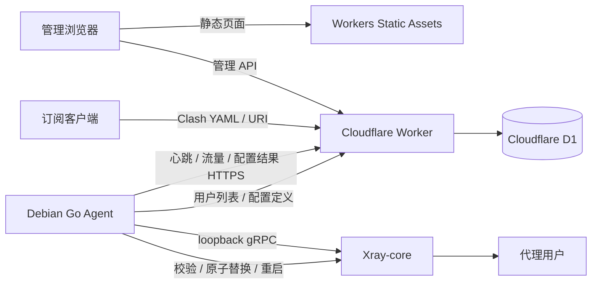
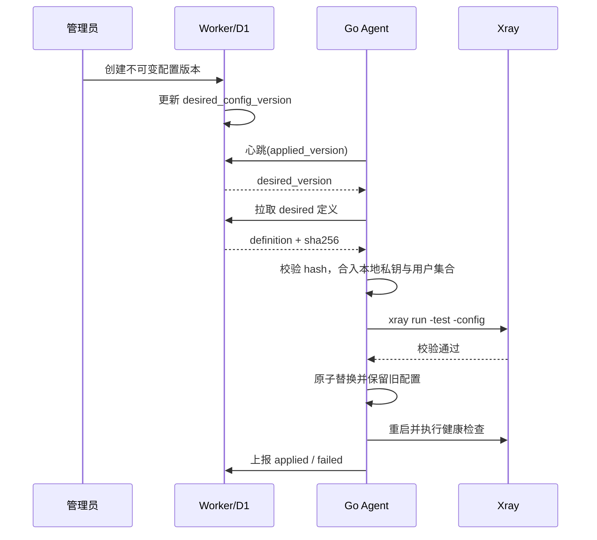

# Zako Panel 系统架构

## 1. 目标与范围

Zako Panel 是轻量代理节点管理面板。Cloudflare Worker 承担控制面，D1 保存持久化数据，Vue SPA 提供管理界面，Debian 上的 Go Agent 负责采集 Xray 统计、同步用户并管理配置。Worker 不转发代理流量，不执行 Xray，不主动连接节点。

### 1.1 阶段划分

| 阶段 | 功能 |
| --- | --- |
| P0 | 节点与默认订阅档案、VLESS + REALITY、Clash.Meta YAML / 通用 URI、规则分发、Agent 心跳与流量上报、幂等入账、节点与客户端流量统计 |
| P1 | 订阅用户、管理员角色、节点授权、独立订阅令牌、流量额度与到期、令牌轮换与撤销、用户集合同步、Xray 热更新、系统指标 |
| P2 | Xray 配置版本化、远程发布、校验、原子切换、失败回滚、配置历史与 diff |

### 1.2 已确认约束

- P0 只支持 VLESS + REALITY，传输为 TCP，流控为 `xtls-rprx-vision`。
- P0 的 Xray 入站与默认用户由安装脚本或管理员在节点本地配置；P1 起用户集合自动同步，P2 起静态配置远程发布。
- 节点在线状态以 Agent 上报为准，Worker 不主动连接节点。
- Xray StatsService 与 HandlerService 只监听节点 loopback；Agent 只发起出站 HTTPS。
- 静态页面由 Workers Static Assets 返回，不经过 Worker；`/api/*` 与 `/sub/*` 进入 Worker。
- 免费额度优先，但鉴权、流量幂等和配置安全不降级。
- 额度与到期采用软限制：停止下发新订阅、从节点用户集合移除，不承诺终止已建立的代理连接。
- 首版不引入 Durable Object、Queues、KV、R2 或第三方控制面；仓库中的 `MyDurableObject` 模板代码在实施时移除，已部署环境用 Wrangler `deleted_classes` 清理。

### 1.3 非目标

首版不实现多租户计费、自动支付、外部订阅转换、WebSocket 长连接、实时硬限速、面板内置 Xray 二进制分发、任意远程命令执行、分钟级原始流量留存。

### 1.4 规模目标

| 指标 | P0 目标 | 预算上限 |
| --- | --- | --- |
| 节点数 | 20 | 100 |
| 订阅用户数 | 50 | 50 |
| 活跃用户-节点组合数 | 50 | 100 |
| 单节点活跃用户上限 | 20 | 20 |
| 流量保留 | 90 天小时桶 / 30 天报表 ID | 同左 |
| 心跳间隔 | 300 秒 | 60–900 秒 |
| 流量上报间隔 | 900 秒 | 300–3600 秒 |

容量以“活跃用户-节点组合数”为主变量。100 节点场景按 100 个组合做容量验证；每节点 50 个活跃用户的密集授权不在免费额度内。超过上限时优先调整上报间隔与保留期；仍然不足则升级 Workers Paid，不假设免费额度无限。

## 2. 核心架构决策

| 决策 | 选择 | 原因 |
| --- | --- | --- |
| 项目结构 | Monorepo | Worker、Web、Agent 与 API 契约统一版本 |
| Worker 路由 | Hono + route / service / repository | 小型运行时，按资源横向扩展 |
| 数据访问 | D1 prepared statements + batch | 明确 SQL、参数绑定与行读取量 |
| API 契约 | OpenAPI 3.1 | 生成 TypeScript 类型；Go 端以契约测试约束 |
| 前端 | Vue 3 + Vite + Vue Router + Pinia | 静态 SPA，无 SSR Worker 开销 |
| UI 组件 | Element Plus + ECharts | 管理表格、表单与流量图表 |
| 管理认证 | Cloudflare Access JWT + D1 RBAC | 避免在 10ms CPU 内执行密码哈希 |
| Agent 认证 | 每节点独立高熵 Bearer token | 可单独撤销，数据库只存哈希 |
| 节点模型 | `nodes` + `endpoints` | P0 单入站，P2 多协议不改表 |
| Agent 上报 | 单端点合并心跳与流量 | 减少重复请求，离线时一次请求补状态 |
| 流量幂等 | `report_id` + payload hash + D1 batch | ACK 丢失、Agent 重装均不重复入账 |
| 流量存储 | 小时桶 + 站点桶 + 用户当前周期汇总 | 图表可聚合，额度检查 O(1) |
| 用户变更 | `users_ver` + 用户列表拉取 + 热更新 | 停用/超额能及时从节点移除 |
| 配置下发 | 不可变定义 + SHA-256 + Agent 本地合入私钥 | 私钥不离开节点，错误配置不替换旧配置 |
| 状态检测 | 心跳时间派生，不写 `online` 字段 | 无逐节点 Cron，无冗余状态写入 |
| 免费额度 | 静态资源走 Assets，控制面只做轻量 CRUD | 请求、CPU 与 D1 写入均可预算 |

首版不设置 `run_worker_first=true`，只对 `/api/*` 与 `/sub/*` 开启 Worker 优先路由。

## 3. 总体架构



### 3.1 控制面与数据面边界

- Worker 不转发代理流量，不保存代理会话，不执行 Xray 二进制。
- Agent 不开放公网管理端口，只发起出站 HTTPS；StatsService 与 HandlerService 仅 loopback。
- Vue 是静态 SPA，不承担订阅令牌或 Agent token 的服务端保护职责。
- D1 是控制面事实来源；Agent 本地状态（计数基线、outbox、用户集合、当前配置）是节点侧事实来源。
- 节点私钥只保存在节点本地；Worker 只保存 REALITY 公钥与配置定义。

## 4. 仓库与模块边界

```text
Zako-Panel/
├── apps/
│   ├── worker/
│   │   └── src/
│   │       ├── index.ts
│   │       ├── routes/
│   │       │   ├── admin/
│   │       │   ├── agent/
│   │       │   └── subscription.ts
│   │       ├── middleware/
│   │       ├── services/
│   │       ├── repositories/
│   │       └── lib/
│   ├── web/
│   │   ├── public/
│   │   │   └── _headers
│   │   └── src/
│   │       ├── api/
│   │       ├── components/
│   │       ├── router/
│   │       ├── stores/
│   │       └── views/
│   └── agent/
│       ├── cmd/zako-agent/main.go
│       ├── internal/
│       │   ├── collector/
│       │   ├── config/
│       │   ├── reporter/
│       │   ├── state/
│       │   ├── syncer/
│       │   ├── sysinfo/
│       │   └── xray/
│       └── go.mod
├── packages/
│   └── contracts/
│       ├── openapi.yaml
│       └── fixtures/
├── deploy/
│   ├── systemd/
│   └── install.sh
├── migrations/
├── docs/
│   └── system-architecture.md
├── wrangler.jsonc
└── package.json
```

### 4.1 Worker 分层

- `routes`：HTTP 参数、状态码、响应组装；不直接拼 SQL。
- `services`：订阅筛选、流量入账、节点状态、用户同步、配置发布等业务规则。
- `repositories`：D1 SQL、batch、查询映射与行数约束。
- `middleware`：Access JWT、Agent token、角色、请求 ID、错误处理、请求体限制。
- `lib`：哈希、随机 token、ULID、YAML/URI、时间与字节工具。

新增资源时新增独立 route 模块与 service，通过 Hono `.route()` 组合。API 统一使用 `/api/v1`；订阅路径使用 `/sub/{token}`；Agent 路径使用 `/api/v1/agent`。

### 4.2 部署配置

```jsonc
{
  "main": "apps/worker/src/index.ts",
  "assets": {
    "directory": "apps/web/dist",
    "not_found_handling": "single-page-application",
    "run_worker_first": ["/api/*", "/sub/*"]
  },
  "d1_databases": [
    {
      "binding": "DB",
      "database_name": "zako-panel",
      "database_id": "<environment-specific-id>"
    }
  ],
  "triggers": {
    "crons": ["*/15 * * * *", "17 3 * * *"]
  },
  "observability": { "enabled": true }
}
```

- `/admin/*` 页面由 Assets 返回，由 Cloudflare Access 路径策略保护。
- `/api/v1/admin/*` 在 Worker 内验证 Access JWT 与 D1 角色。
- `/api/v1/agent/*` 与 `/sub/*` 排除在 Access 之外，使用各自鉴权。
- 静态 `_headers` 设置 CSP、`X-Content-Type-Options: nosniff`、`Referrer-Policy: no-referrer`、受限 Permissions Policy；不通过 Worker 注入静态页面安全头。
- 环境变量：`ACCESS_TEAM_DOMAIN`、`ACCESS_AUD`、`ENVIRONMENT`。生产环境禁止开发态管理员旁路。

### 4.3 Web 应用

| 页面 | 阶段 | 内容 |
| --- | --- | --- |
| 总览 | P0 | 节点状态数量、站点流量、最近异常 |
| 节点 | P0 | 创建/编辑、公网参数、心跳、版本、token 轮换 |
| 节点详情 | P0 | 派生状态、流量曲线、用户凭据、配置错误；P1 增加系统指标 |
| 订阅档案 | P0 | 节点选择、规则编辑、Clash 预览 |
| 订阅 | P0 | 链接复制、格式选择、撤销与轮换 |
| 流量 | P0 | 时间范围、节点维度汇总与图表 |
| 订阅用户 | P1 | 额度、周期、到期与节点授权 |
| 管理员 | P1 | Access 身份与角色 |
| 配置中心 | P2 | 版本 diff、发布、结果与回滚 |

- 路由懒加载，ECharts 独立异步 chunk。
- 状态轮询 30–60 秒，页面隐藏时暂停；流量页不高频轮询。
- 订阅与 Agent token 只在创建或轮换时显示一次，不写入 `localStorage`。
- 管理 API 使用同源请求与 Access Cookie，不在前端保存长期凭据。
- 所有页面由静态 Assets 返回；前端不承担服务端鉴权。

## 5. API 契约

### 5.1 通用约定

成功响应：

```json
{
  "data": {},
  "meta": {
    "request_id": "01J..."
  }
}
```

错误响应：

```json
{
  "error": {
    "code": "NODE_NOT_FOUND",
    "message": "Node not found",
    "request_id": "01J..."
  }
}
```

- 列表使用 `limit + cursor`，默认 50，最大 200；不使用深分页 offset。
- 所有输入在路由边界校验；SQL 全部使用绑定参数。
- 管理 API 不开放跨域；前端同源请求。
- 请求 ID 使用 ULID，写入日志与响应头 `X-Request-Id`。
- 不在日志、错误堆栈或分析事件中记录 token、完整订阅 URL、UUID 或请求体。
- TypeScript 类型由 `packages/contracts/openapi.yaml` 生成；Go 端结构体手写，并用 `packages/contracts/fixtures` 做契约测试。

### 5.2 管理 API

| 方法与路径 | 阶段 | 用途 |
| --- | --- | --- |
| `GET/POST /api/v1/admin/nodes` | P0 | 节点列表、创建节点（可同时创建首个 endpoint） |
| `GET/PATCH /api/v1/admin/nodes/{id}` | P0 | 节点详情、心跳间隔与启用状态 |
| `POST /api/v1/admin/nodes/{id}/agent-token/rotate` | P0 | 轮换 Agent token，返回一次性明文 |
| `GET /api/v1/admin/nodes/{id}/status` | P0 | 心跳、健康、版本与最近配置错误 |
| `GET/POST /api/v1/admin/nodes/{id}/endpoints` | P0/P2 | endpoint 列表与新增；P0 只有一个 |
| `PATCH/DELETE /api/v1/admin/nodes/{id}/endpoints/{endpointId}` | P0/P2 | 修改或停用 endpoint |
| `GET/POST /api/v1/admin/profiles` | P0 | 订阅档案列表与创建 |
| `GET/PATCH/DELETE /api/v1/admin/profiles/{id}` | P0 | 节点选择、Clash 基础字段、代理组与规则 |
| `GET/POST /api/v1/admin/subscriptions` | P0 | 订阅列表与创建，创建时返回一次性 token |
| `POST /api/v1/admin/subscriptions/{id}/rotate` | P0 | 生成新 token 并撤销旧 token |
| `POST /api/v1/admin/subscriptions/{id}/revoke` | P0 | 撤销订阅 |
| `GET /api/v1/admin/traffic/summary` | P0 | 按时间、节点或用户聚合流量 |
| `GET/POST /api/v1/admin/subscribers` | P1 | 用户、额度、周期与到期管理 |
| `GET/PATCH /api/v1/admin/subscribers/{id}` | P1 | 用户详情与状态 |
| `PUT /api/v1/admin/subscribers/{id}/nodes` | P1 | 整体替换节点授权，创建或停用 `node_clients` |
| `GET/POST/PATCH /api/v1/admin/admins` | P1 | 管理员角色管理 |
| `GET/POST /api/v1/admin/nodes/{id}/configs` | P2 | 创建并发布配置版本、查看历史 |
| `GET /api/v1/admin/nodes/{id}/configs/{version}` | P2 | 配置详情与 diff 数据 |
| `POST /api/v1/admin/nodes/{id}/configs/{version}/rollback` | P2 | 从历史定义创建新版本 |

流量汇总支持 `from`、`to`、`groupBy=node|subscriber|site`、`nodeId`、`subscriberId`；最大时间范围 31 天。`from`、`to` 为 Unix 秒，归一到小时边界。

创建节点时，节点与首个 endpoint 在同一 D1 batch 写入，并为当前默认订阅用户创建 `node_clients`。P1 的 `PUT /subscribers/{id}/nodes` 为新增授权补齐凭据。

### 5.3 Agent API

#### 上报

`POST /api/v1/agent/report`

```json
{
  "sent_at": 1780000000,
  "agent_version": "0.1.0",
  "xray_version": "25.10.1",
  "xray_healthy": true,
  "stats_healthy": true,
  "applied_config_version": 3,
  "users_ver": 12,
  "sys": {
    "cpu": 0.12,
    "mem": 0.41,
    "load": 0.30,
    "uptime": 86400
  },
  "traffic": {
    "report_id": "01J2Z6Q8Y3V9M4K7T1B5C0D2E6",
    "period_start": 1780000000,
    "period_end": 1780000900,
    "has_counter_gap": false,
    "node": {
      "uplink_bytes": 10240,
      "downlink_bytes": 204800
    },
    "users": [
      {
        "xray_email": "u_01J2Z6Q8Y3V9M4K7T1B5C0D2E6",
        "uplink_bytes": 10240,
        "downlink_bytes": 204800
      }
    ]
  }
}
```

响应：

```json
{
  "data": {
    "ack_report_id": "01J2Z6Q8Y3V9M4K7T1B5C0D2E6",
    "server_time": 1780000002,
    "heartbeat_interval_seconds": 300,
    "traffic_interval_seconds": 900,
    "users_ver": 13,
    "desired_config_version": 3,
    "unknown_users": 0,
    "directives": []
  }
}
```

规则：

- 心跳与流量共用一个端点；纯心跳请求省略 `traffic`，`ack_report_id` 为 `null`。
- 单份报表最多 40 个用户条目、64 KB；超出返回 `413`，Agent 切分后重试。
- `period_end > period_start`，跨度不超过 3600 秒；`period_start` 与 `period_end - 1` 必须位于同一小时桶，跨桶返回 `422`，由 Agent 在采样侧切分。
- `period_end` 允许最多 5 分钟未来偏移；超过 7 天的报表返回 `422`。
- 同一报表内的 `xray_email` 必须唯一；重复条目由 Agent 聚合，Worker 收到重复条目返回 `422`。
- `payload_hash` 为 `traffic` 对象规范化 JSON（键排序）的 SHA-256；同一 `report_id` 重复提交且 hash 相同按成功返回，hash 不同返回 `409 REPORT_CONFLICT`。
- Agent 收到 `409` 丢弃该报表并告警，不阻塞后续队列。
- 未知 `xray_email` 仍计入节点与站点流量，跳过用户汇总，响应包含 `unknown_users` 计数。
- 心跳字段先于流量批次提交；流量批次失败不会让节点被判离线。
- Agent 以响应中的 `heartbeat_interval_seconds` 与 `traffic_interval_seconds` 为准，持久化后在下一次调度生效。
- `sys` 为可选字段，限制 2 KB；P1 UI 使用，P0 可忽略。
- `directives` 保留给未来扩展，当前返回空数组；旧 Agent 忽略未知类型。

#### 用户列表

`GET /api/v1/agent/users`

```json
{
  "data": {
    "version": 13,
    "users": [
      {
        "xray_email": "u_01J...",
        "vless_uuid": "00000000-0000-0000-0000-000000000000"
      }
    ]
  }
}
```

- 只返回该节点上启用且订阅用户状态为 `active` 的凭据。
- 支持 `If-None-Match`；版本未变化返回 `304`。

#### 配置（P2）

- `GET /api/v1/agent/config`：返回当前 `desired_config_version` 的定义、SHA-256 与版本；Agent 版本已是最新时返回 `204`。
- `POST /api/v1/agent/config/result`：

```json
{
  "version": 4,
  "status": "applied",
  "applied_at": 1780000000,
  "error": null
}
```

- `status` 取 `applied` / `failed`；错误包含 `code` 与 `message`，不包含私钥或完整配置。
- 迟到的旧版本结果不能覆盖更新版本状态。

### 5.4 订阅 API

- `GET /sub/{token}/clash.yaml`
- `GET /sub/{token}/uri?encoding=base64`
- `GET /sub/{token}/uri?encoding=plain`

状态码：

| 状态码 | 条件 |
| --- | --- |
| `401` | token 不存在或已撤销 |
| `403` | 订阅用户停用、到期、超额，或订阅本身到期 |
| `503` | 身份有效，但当前没有可分发节点 |
| `400` | 不支持的编码或格式 |
| `404` | 未知路径 |

订阅 token 明文只在创建或轮换响应中出现一次；管理和 Agent API 不返回明文。

## 6. D1 数据模型

### 6.1 通用约定

- ID 使用不可预测的 ULID 文本；`xray_email` 使用 `u_<ULID>`，不含个人信息。
- 邮箱字段统一做 trim 与小写规范化后再比较和建立唯一索引。
- 时间统一为 Unix 秒 INTEGER；API 使用 Unix 秒，字段名以 `_at` 结尾；前端负责本地化显示。
- 流量字节使用非负 INTEGER；JSON 中超过 `2^53-1` 时使用十进制字符串。
- `NULL` 表示不限量或永不到期；不使用 `0` 表达无限。
- 所有外键显式声明；有历史流量的节点与用户采用停用，不做物理删除。
- 迁移只追加 SQL 文件；部署前在 staging 验证并备份。

### 6.2 核心表

```sql
CREATE TABLE nodes (
  id TEXT PRIMARY KEY,
  name TEXT NOT NULL,
  enabled INTEGER NOT NULL DEFAULT 1 CHECK (enabled IN (0, 1)),
  agent_token_hash TEXT NOT NULL,
  heartbeat_interval_seconds INTEGER NOT NULL DEFAULT 300
    CHECK (heartbeat_interval_seconds BETWEEN 60 AND 900),
  last_seen_at INTEGER,
  xray_healthy INTEGER CHECK (xray_healthy IN (0, 1)),
  stats_healthy INTEGER CHECK (stats_healthy IN (0, 1)),
  agent_version TEXT,
  xray_version TEXT,
  sys_json TEXT,
  desired_config_version INTEGER NOT NULL DEFAULT 0,
  applied_config_version INTEGER NOT NULL DEFAULT 0,
  last_config_error TEXT,
  last_config_at INTEGER,
  created_at INTEGER NOT NULL,
  updated_at INTEGER NOT NULL
);

CREATE UNIQUE INDEX idx_nodes_name ON nodes(name);
CREATE UNIQUE INDEX idx_nodes_token ON nodes(agent_token_hash);
CREATE INDEX idx_nodes_enabled ON nodes(enabled);

CREATE TABLE endpoints (
  id TEXT PRIMARY KEY,
  node_id TEXT NOT NULL REFERENCES nodes(id) ON DELETE CASCADE,
  name TEXT NOT NULL,
  protocol TEXT NOT NULL,
  host TEXT NOT NULL,
  port INTEGER NOT NULL CHECK (port BETWEEN 1 AND 65535),
  params_json TEXT NOT NULL,
  enabled INTEGER NOT NULL DEFAULT 1 CHECK (enabled IN (0, 1)),
  created_at INTEGER NOT NULL,
  updated_at INTEGER NOT NULL,
  UNIQUE (node_id, name)
);

CREATE INDEX idx_endpoints_node_enabled ON endpoints(node_id, enabled);
```

`params_json` 按协议校验：P0 为 `vless-reality`，字段包含 `sni`、`public_key`、`short_id`、`fingerprint`、`flow`、`network`；不接受任意 YAML 片段。

```sql
CREATE TABLE subscribers (
  id TEXT PRIMARY KEY,
  name TEXT NOT NULL,
  email TEXT,
  status TEXT NOT NULL DEFAULT 'active'
    CHECK (status IN ('active', 'limited', 'expired', 'disabled')),
  traffic_limit_bytes INTEGER
    CHECK (traffic_limit_bytes IS NULL OR traffic_limit_bytes >= 0),
  expires_at INTEGER,
  usage_cycle_start INTEGER NOT NULL,
  usage_cycle_end INTEGER NOT NULL,
  created_at INTEGER NOT NULL,
  updated_at INTEGER NOT NULL
);

CREATE UNIQUE INDEX idx_subscribers_email
  ON subscribers(email) WHERE email IS NOT NULL;
CREATE INDEX idx_subscribers_status ON subscribers(status);

CREATE TABLE node_clients (
  id TEXT PRIMARY KEY,
  node_id TEXT NOT NULL REFERENCES nodes(id) ON DELETE CASCADE,
  subscriber_id TEXT NOT NULL REFERENCES subscribers(id) ON DELETE RESTRICT,
  xray_email TEXT NOT NULL,
  vless_uuid TEXT NOT NULL,
  enabled INTEGER NOT NULL DEFAULT 1 CHECK (enabled IN (0, 1)),
  created_at INTEGER NOT NULL,
  updated_at INTEGER NOT NULL,
  UNIQUE (node_id, xray_email),
  UNIQUE (node_id, vless_uuid),
  UNIQUE (subscriber_id, node_id)
);

CREATE INDEX idx_node_clients_subscriber
  ON node_clients(subscriber_id, enabled);
```

`node_clients` 同时表达节点授权与凭据。P1 的 `PUT /subscribers/{id}/nodes` 对新增节点创建行，对移除节点置 `enabled=0` 而不删除，保留流量归属。多 endpoint 复用同一 `node_client`；需要协议独立凭据时再增加 `endpoint_clients` 表，不在 P0 提前抽象。

```sql
CREATE TABLE subscription_profiles (
  id TEXT PRIMARY KEY,
  name TEXT NOT NULL UNIQUE,
  description TEXT,
  node_selection TEXT NOT NULL DEFAULT 'all'
    CHECK (node_selection IN ('all', 'selected')),
  online_only INTEGER NOT NULL DEFAULT 1 CHECK (online_only IN (0, 1)),
  clash_base_json TEXT NOT NULL DEFAULT '{}',
  proxy_groups_json TEXT NOT NULL DEFAULT '[]',
  rules_json TEXT NOT NULL DEFAULT '[]',
  revision INTEGER NOT NULL DEFAULT 1,
  created_at INTEGER NOT NULL,
  updated_at INTEGER NOT NULL
);

CREATE TABLE profile_nodes (
  profile_id TEXT NOT NULL
    REFERENCES subscription_profiles(id) ON DELETE CASCADE,
  node_id TEXT NOT NULL REFERENCES nodes(id) ON DELETE CASCADE,
  PRIMARY KEY (profile_id, node_id)
) WITHOUT ROWID;

CREATE TABLE subscriptions (
  id TEXT PRIMARY KEY,
  subscriber_id TEXT NOT NULL
    REFERENCES subscribers(id) ON DELETE RESTRICT,
  profile_id TEXT NOT NULL REFERENCES subscription_profiles(id),
  name TEXT NOT NULL,
  token_hash TEXT NOT NULL UNIQUE,
  revoked_at INTEGER,
  expires_at INTEGER,
  created_at INTEGER NOT NULL
);

CREATE INDEX idx_subscriptions_subscriber
  ON subscriptions(subscriber_id, revoked_at);

CREATE TABLE admin_users (
  id TEXT PRIMARY KEY,
  email TEXT NOT NULL,
  role TEXT NOT NULL CHECK (role IN ('owner', 'admin', 'viewer')),
  enabled INTEGER NOT NULL DEFAULT 1 CHECK (enabled IN (0, 1)),
  created_at INTEGER NOT NULL,
  updated_at INTEGER NOT NULL
);

CREATE UNIQUE INDEX idx_admin_users_email ON admin_users(email);
```

### 6.3 流量表

```sql
CREATE TABLE traffic_reports (
  node_id TEXT NOT NULL REFERENCES nodes(id) ON DELETE CASCADE,
  report_id TEXT NOT NULL,
  payload_hash TEXT NOT NULL,
  period_start INTEGER NOT NULL,
  period_end INTEGER NOT NULL,
  item_count INTEGER NOT NULL,
  has_counter_gap INTEGER NOT NULL DEFAULT 0
    CHECK (has_counter_gap IN (0, 1)),
  received_at INTEGER NOT NULL,
  PRIMARY KEY (node_id, report_id)
) WITHOUT ROWID;

CREATE TABLE node_traffic_hourly (
  node_id TEXT NOT NULL REFERENCES nodes(id) ON DELETE CASCADE,
  bucket_start INTEGER NOT NULL,
  uplink_bytes INTEGER NOT NULL DEFAULT 0,
  downlink_bytes INTEGER NOT NULL DEFAULT 0,
  updated_at INTEGER NOT NULL,
  PRIMARY KEY (node_id, bucket_start)
) WITHOUT ROWID;

CREATE TABLE site_traffic_hourly (
  bucket_start INTEGER PRIMARY KEY,
  uplink_bytes INTEGER NOT NULL DEFAULT 0,
  downlink_bytes INTEGER NOT NULL DEFAULT 0,
  updated_at INTEGER NOT NULL
) WITHOUT ROWID;

CREATE TABLE user_traffic_hourly (
  subscriber_id TEXT NOT NULL REFERENCES subscribers(id) ON DELETE RESTRICT,
  node_id TEXT NOT NULL REFERENCES nodes(id) ON DELETE CASCADE,
  bucket_start INTEGER NOT NULL,
  uplink_bytes INTEGER NOT NULL DEFAULT 0,
  downlink_bytes INTEGER NOT NULL DEFAULT 0,
  updated_at INTEGER NOT NULL,
  PRIMARY KEY (subscriber_id, node_id, bucket_start)
) WITHOUT ROWID;

CREATE TABLE subscriber_usage (
  subscriber_id TEXT PRIMARY KEY
    REFERENCES subscribers(id) ON DELETE RESTRICT,
  cycle_start INTEGER NOT NULL,
  uplink_bytes INTEGER NOT NULL DEFAULT 0,
  downlink_bytes INTEGER NOT NULL DEFAULT 0,
  updated_at INTEGER NOT NULL
) WITHOUT ROWID;
```

设计说明：

- `site_traffic_hourly` 维护全站小时汇总，避免给 `node_traffic_hourly` 增加 `(bucket_start)` 二级索引。每次报表多写 1 行，换取仪表盘 O(24) 读取与节点桶无索引写入。
- `user_traffic_hourly` 以订阅用户为前缀，用户详情与排行按用户读取；不建额外索引。
- `subscriber_usage` 只保留当前周期汇总，额度判断与 `subscription-userinfo` 读取 O(1)。
- 小时桶保留 90 天；`traffic_reports` 保留 30 天；清理按主键或时间范围小批次执行，删除同样计入 D1 写入。

### 6.4 配置与元数据

```sql
CREATE TABLE node_configs (
  node_id TEXT NOT NULL REFERENCES nodes(id) ON DELETE CASCADE,
  version INTEGER NOT NULL,
  definition_json TEXT NOT NULL,
  definition_sha256 TEXT NOT NULL,
  created_by TEXT REFERENCES admin_users(id),
  created_at INTEGER NOT NULL,
  applied_at INTEGER,
  last_error TEXT,
  PRIMARY KEY (node_id, version)
) WITHOUT ROWID;

CREATE TABLE meta (
  k TEXT PRIMARY KEY,
  v TEXT NOT NULL
) WITHOUT ROWID;

CREATE TABLE audit_events (
  id TEXT PRIMARY KEY,
  actor_email TEXT,
  action TEXT NOT NULL,
  target_type TEXT,
  target_id TEXT,
  detail_json TEXT,
  created_at INTEGER NOT NULL
);

CREATE INDEX idx_audit_created ON audit_events(created_at);
```

`meta` 保存 `users_ver`（全局用户集合版本）与少量运行时设置。`definition_json` 不含 REALITY 私钥与用户凭据；版本号在节点内严格递增，回滚创建新版本而非降低版本号。

### 6.5 初始化

部署时执行一次引导脚本：

1. 写入首个 `owner` 管理员（邮箱来自 `ADMIN_EMAIL`）。
2. 创建默认订阅档案（`all` 节点、默认规则）。
3. 创建默认订阅用户与订阅记录，生成随机 token 并只在交互终端输出一次。
4. 写入 `meta.users_ver = 0`。

生产环境不提供“空表首个登录者自动成为 owner”的运行时逻辑。

## 7. 节点状态与分发条件

不持久化冗余 `online` 字段，查询时统一派生：

| 状态 | 条件 |
| --- | --- |
| `disabled` | `nodes.enabled = 0` |
| `offline` | 从未心跳，或当前时间晚于 `last_seen_at + 3 × heartbeat_interval_seconds` |
| `degraded` | 心跳新鲜，但 `xray_healthy = 0` 或 `stats_healthy = 0` |
| `online` | 心跳新鲜且两者健康 |

分发条件与展示状态略有区别：

- `nodes.enabled = 1`，至少一个 `endpoints.enabled = 1`。
- 心跳新鲜。
- `xray_healthy = 1`；`stats_healthy = 0` 仍可分发，避免统计故障导致节点全部消失。
- 订阅用户状态为 `active`，且在有效期内、未超额。
- `node_clients.enabled = 1`。
- 档案为 `selected` 时，节点在 `profile_nodes` 中。
- `online_only = 1` 时按上述新鲜度过滤；`online_only = 0` 时允许离线节点进入配置。

没有任何可分发节点时返回 `503`，不下发空配置。

停用节点或 endpoint 只改变控制面分发；运行中的 Xray 由 P2 配置发布或管理员在节点本地操作收敛。

## 8. 流量采集与入账

### 8.1 Xray 统计配置

Xray 配置必须包含 stats、policy、API inbound 与 routing：

```json
{
  "stats": {},
  "policy": {
    "levels": {
      "0": {
        "statsUserUplink": true,
        "statsUserDownlink": true
      }
    },
    "system": {
      "statsInboundUplink": true,
      "statsInboundDownlink": true
    }
  },
  "api": {
    "tag": "api",
    "services": ["StatsService", "HandlerService"]
  },
  "inbounds": [
    {
      "tag": "api",
      "listen": "127.0.0.1",
      "port": 10085,
      "protocol": "dokodemo-door",
      "settings": { "address": "127.0.0.1" }
    }
  ],
  "routing": {
    "rules": [
      { "type": "field", "inboundTag": ["api"], "outboundTag": "api" }
    ]
  }
}
```

- 每个需要统计的用户设置稳定且唯一的 `email`，对应 `node_clients.xray_email`。
- 统计键：`user>>>EMAIL>>>traffic>>>uplink|downlink`、`inbound>>>TAG>>>traffic>>>uplink|downlink`。
- 节点流量只汇总代理 inbound tag，排除 `api` inbound，避免把本地 API 流量计入用户流量。
- Agent 使用 `QueryStats(pattern="user>>>", reset=false)`、inbound 查询与 `GetSysStats`；不使用 `reset=true`。

### 8.2 Agent 采样与增量

```text
每 30 秒读取原始计数器：
  首次看到计数器：只建立基线，不回填未知历史
  当前值 >= 基线：delta = 当前值 - 基线
  当前值 < 基线或 Xray uptime 回退：delta = 当前值，标记 counter gap
  缺失计数器：记录异常，不产生负 delta

在同一 BoltDB 事务中：
  保存 delta 到当前未结算报表
  更新原始计数基线与 Xray uptime

每 15 分钟（默认，Worker 下发）：
  按小时边界和 40 个用户条目上限切分非零 delta
  为每份报表生成持久 report_id 并关闭批次
  发送最早未 ACK 报表
  只有收到报告级 ACK 才删除 outbox
```

- 报表 `period_start`/`period_end` 必须落在同一小时桶；跨边界时按采样时间切分，无法精确归属的尾部计入下一小时并标记 `has_counter_gap`。
- Agent 重启后从 BoltDB 恢复基线、outbox、`users_ver` 与配置版本。
- 网络失败采用指数退避与 jitter；Worker 返回 `429` 时遵守 `Retry-After` 或加大退避。
- Agent 使用心跳返回的 `server_time` 检测明显时钟偏移，节点仍应通过 timesyncd/NTP 校时。
- outbox 中超过 7 天的报表丢弃并记录告警，避免与 Worker 报表 ID 保留期冲突。

### 8.3 Worker 幂等入账

单次上报按以下顺序处理：

1. 验证 Agent token 与请求体。
2. `batch` 提交心跳更新，并读取该节点用户映射与订阅周期：

```sql
UPDATE nodes
SET last_seen_at = ?, xray_healthy = ?, stats_healthy = ?,
    agent_version = ?, xray_version = ?, sys_json = ?,
    applied_config_version = ?, updated_at = ?
WHERE id = ?;

SELECT subscriber_id, xray_email
FROM node_clients
WHERE node_id = ? AND xray_email IN (/* ≤ 40 个绑定参数 */);

SELECT id, usage_cycle_start, status, traffic_limit_bytes, expires_at
FROM subscribers
WHERE id IN (/* 去重后的订阅用户 */);
```

3. 将 `xray_email` 映射为 `subscriber_id`；未知邮箱只计入节点与站点桶。
4. `batch` 提交流量，顺序固定：

```sql
INSERT INTO traffic_reports
  (node_id, report_id, payload_hash, period_start, period_end,
   item_count, has_counter_gap, received_at)
VALUES (?, ?, ?, ?, ?, ?, ?, ?);

INSERT INTO node_traffic_hourly
  (node_id, bucket_start, uplink_bytes, downlink_bytes, updated_at)
VALUES (?, ?, ?, ?, ?)
ON CONFLICT(node_id, bucket_start) DO UPDATE SET
  uplink_bytes = node_traffic_hourly.uplink_bytes + excluded.uplink_bytes,
  downlink_bytes = node_traffic_hourly.downlink_bytes + excluded.downlink_bytes,
  updated_at = excluded.updated_at;

INSERT INTO site_traffic_hourly
  (bucket_start, uplink_bytes, downlink_bytes, updated_at)
VALUES (?, ?, ?, ?)
ON CONFLICT(bucket_start) DO UPDATE SET
  uplink_bytes = site_traffic_hourly.uplink_bytes + excluded.uplink_bytes,
  downlink_bytes = site_traffic_hourly.downlink_bytes + excluded.downlink_bytes,
  updated_at = excluded.updated_at;

-- 每 16 行一条语句，6 个绑定参数/行，避免超过 100 参数限制
INSERT INTO user_traffic_hourly
  (subscriber_id, node_id, bucket_start, uplink_bytes, downlink_bytes, updated_at)
VALUES (?, ?, ?, ?, ?, ?), (?, ?, ?, ?, ?, ?) /* ... */
ON CONFLICT(subscriber_id, node_id, bucket_start) DO UPDATE SET
  uplink_bytes = user_traffic_hourly.uplink_bytes + excluded.uplink_bytes,
  downlink_bytes = user_traffic_hourly.downlink_bytes + excluded.downlink_bytes,
  updated_at = excluded.updated_at;

-- 每 20 行一条语句，5 个绑定参数/行
INSERT INTO subscriber_usage
  (subscriber_id, cycle_start, uplink_bytes, downlink_bytes, updated_at)
VALUES (?, ?, ?, ?, ?), (?, ?, ?, ?, ?) /* ... */
ON CONFLICT(subscriber_id) DO UPDATE SET
  uplink_bytes = CASE
    WHEN subscriber_usage.cycle_start = excluded.cycle_start
    THEN subscriber_usage.uplink_bytes + excluded.uplink_bytes
    ELSE excluded.uplink_bytes END,
  downlink_bytes = CASE
    WHEN subscriber_usage.cycle_start = excluded.cycle_start
    THEN subscriber_usage.downlink_bytes + excluded.downlink_bytes
    ELSE excluded.downlink_bytes END,
  cycle_start = excluded.cycle_start,
  updated_at = excluded.updated_at;
```

5. 若 `traffic_reports` 插入触发唯一约束，整个流量 batch 回滚；Worker 查询该 `report_id` 的 `payload_hash`：相同则按成功返回 ACK，不同则返回 `409`。心跳批次已提交，节点状态不受影响。
6. `subscriber_usage.cycle_start` 使用订阅用户当前的 `usage_cycle_start`；周期已滚动时，CASE 分支重置累计值。
7. `traffic.users` 先按 `xray_email` 聚合；重复条目返回 `422`，不进入 batch。
8. `payload_hash` 对 `traffic` 对象做规范化 JSON（键排序）后计算 SHA-256，保证 Agent 重试时字节差异不影响幂等判断。
9. 心跳中的 `applied_config_version` 只接受不大于 `desired_config_version` 的值；权威 applied 状态由 `config/result` 更新。

报表切分后每份报表独立 `report_id`、独立 batch；单份失败不影响其他报表。D1 batch 是原子事务，任一语句失败会回滚整个 batch。

### 8.4 额度与周期

- `subscribers.usage_cycle_start` / `usage_cycle_end` 定义当前周期；默认创建时设为当月至下月同日，月末按目标月最后一天截断；周期边界按 UTC 计算。
- 每 15 分钟 Cron 检查：`now >= usage_cycle_end` 时推进周期、重置 `subscriber_usage` 并更新订阅用户。
- 周期内状态按以下优先级派生并物化到 `subscribers.status`：`disabled`（管理员停用）优先，其次 `expired`（`expires_at <= now`），其次 `limited`（有限额且 `usage >= limit`），否则 `active`。
- 状态变化时递增 `meta.users_ver`，触发 Agent 拉取用户列表。
- 管理员修改额度、到期、状态或节点授权时，在同一 D1 batch 中更新订阅用户并递增 `users_ver`。
- 订阅请求实时校验状态、额度与到期，不依赖 Cron 的物化结果。
- 超额与到期是软限制：从节点移除用户后，已建立的连接可能继续存在。

### 8.5 Agent 进程与部署

| 模块 | 职责 |
| --- | --- |
| `config` | 读取少量 YAML/环境配置并校验 |
| `collector` | 定时读取 StatsService、计算增量 |
| `state` | BoltDB 基线、Xray uptime、outbox、用户集合与版本 |
| `reporter` | 心跳、流量重试、退避与 jitter |
| `syncer` | 用户集合拉取、持久化与热更新 |
| `sysinfo` | CPU、内存、负载、uptime |
| `xray` | gRPC 客户端、配置渲染/校验/应用 |
| `cmd/zako-agent` | 依赖组装、signal 与优雅退出 |

```yaml
control_plane_url: https://panel.example.com
node_id: <node-id>
agent_token_file: /etc/zako-agent/token
state_path: /var/lib/zako-agent/state.db
users_path: /var/lib/zako-agent/users.json
xray_config_path: /etc/xray/config.json
xray_binary_path: /usr/local/bin/xray
reality_private_key_path: /etc/xray/reality.key
heartbeat_interval: 5m
collector:
  sample_interval: 30s
  report_interval: 15m
```

- 安装脚本运行 `xray x25519` 生成 REALITY 密钥对，私钥写入 0600 文件，公钥由管理员录入 endpoint。
- token、私钥、状态文件与用户集合权限为 0600。
- Agent 构建为 `CGO_ENABLED=0` 的 Linux amd64/arm64 静态二进制，由 systemd 管理；退出时先完成当前状态事务再结束。
- systemd 限制 Agent 只写 `/etc/xray` 与 `/var/lib/zako-agent`，仅执行固定路径的 Xray 校验与重启命令。
- P0 的 Xray 入站由安装脚本初始化；默认用户凭据由管理员从面板复制后写入。P1 起用户集合同步接管，P2 起静态配置远程发布。

## 9. 用户同步与 Xray 热更新

### 9.1 版本与拉取

- `meta.users_ver` 是全局用户集合版本；新增、停用、删除授权、状态变化、凭据启停都会递增。
- 创建节点时在同一 batch 内为默认订阅用户创建 `node_clients`；P1 的授权接口为新增用户/节点补齐凭据。没有凭据的用户不会进入订阅。
- Agent 心跳/上报响应携带 `users_ver`；发现变化时调用 `GET /api/v1/agent/users`。
- 用户列表只包含该节点上 `node_clients.enabled=1` 且订阅用户 `status=active` 的凭据。
- Agent 使用 `If-None-Match` 避免重复传输；响应版本写入本地状态。
- P0 的 Xray 用户由管理员从面板复制后手工维护；P1 起由本同步链路接管。

### 9.2 应用与持久化

- Agent 收到新用户集合后，先写临时 `users.json` 并 fsync，再原子 rename 到状态目录，权限 0600。
- 优先通过 `HandlerService.AlterInbound` 的 `AddUser` / `RemoveUser` 热更新。VLESS 需要构造 `AddUserOperation`，包含 `email`、`level=0` 与 `Account`；`Account` 必须带 `uuid` 与 `flow=xtls-rprx-vision`。
- 同时用当前静态配置、用户集合与本地 REALITY 私钥渲染完整 Xray 配置，原子写入磁盘。运行中的热更新与磁盘配置保持一致，重启后不丢失用户。
- 热更新失败时回退为“写入配置 + 重启”，重启后执行健康检查；失败则恢复上一份已知可用配置。
- Agent 启动时以磁盘上的完整配置为准，并再次核对 `users_ver`；发现落后立即拉取。
- `RemoveUser` 不会主动终止已建立的连接；同步只阻止新连接与后续配置刷新。

### 9.3 并发控制

- 用户同步与配置发布共用一把 Agent 内的互斥锁，避免同时修改配置。
- 配置应用期间到达的用户版本在应用完成后重新同步。
- 同一节点同时只允许一个 apply 操作；旧版本结果按版本号丢弃。

## 10. P2 远程配置

### 10.1 定义与版本

- `definition_json` 描述节点静态配置：日志、DNS、入站协议与公共参数、出站、路由、policy、stats、API inbound。
- 定义不包含 REALITY 私钥与用户凭据；私钥由 Agent 合入，用户由 `users_ver` 同步。
- 用户、额度与授权变化只递增 `users_ver`，不创建配置版本；配置版本只覆盖静态定义。
- `definition_sha256` 为规范化 JSON（键排序、无多余空白）的 SHA-256；版本在节点内严格递增。
- 发布时更新 `nodes.desired_config_version`；Agent 心跳获取 desired，按需拉取。

### 10.2 发布流程



### 10.3 状态机与回滚

`IDLE → DOWNLOADING → VERIFYING → RENDERING → TESTING → APPLYING → OBSERVING → APPLIED / FAILED`。

- 下载后先验证 Worker definition 的 SHA-256，再合入本地私钥与当前用户集合。
- 新文件与目标文件位于同一文件系统，写临时文件并 fsync 后原子 rename。
- 使用 `xray run -test -config <file>` 校验。
- 保留最近已知可用配置；重启或观察期健康检查失败时恢复并再次启动旧配置。
- 只有 `config/result` 更新权威 applied 状态；心跳中的 applied 值只用于展示，超过 desired 时忽略。
- 相同版本重复应用与重复结果上报保持幂等；迟到的旧版本结果不能覆盖新版本。
- Agent 离线期间只保留最新 desired；恢复后直接追赶最新版本，不逐版本重放。
- 配置 API 只接受结构化定义，不接受 shell 命令。Agent 只执行固定路径的 Xray 校验与重启命令。

## 11. 订阅生成

### 11.1 查询顺序

1. 对 URL token 做 SHA-256，以唯一索引查询订阅与订阅用户。
2. 校验订阅撤销、订阅到期、用户状态与到期。
3. 一次 `batch` 读取：档案、`profile_nodes`、`node_clients`、节点、启用的 endpoints、`subscriber_usage`。
4. 若 `subscriber_usage.cycle_start` 早于订阅用户当前周期，按 0 处理；再校验额度。
5. 取档案节点集合与用户授权集合的交集。
6. 过滤停用节点、停用 endpoint、离线节点（`online_only`）与不健康 Xray。
7. 生成稳定且唯一的节点名称；单 endpoint 使用节点名，多 endpoint 使用“节点名-endpoint 名”。
8. 序列化 Clash YAML 或 URI，不调用外部转换服务。

查询使用 JOIN 与批量 `IN`，不逐节点查询。

### 11.2 Clash.Meta YAML

```yaml
mixed-port: 7890
allow-lan: false
mode: rule
log-level: info
proxies:
  - name: Tokyo-01
    type: vless
    server: 203.0.113.10
    port: 443
    uuid: 00000000-0000-0000-0000-000000000000
    network: tcp
    tls: true
    udp: true
    flow: xtls-rprx-vision
    servername: www.example.com
    reality-opts:
      public-key: <reality-public-key>
      short-id: <short-id>
    client-fingerprint: chrome
proxy-groups:
  - name: PROXY
    type: select
    proxies:
      - AUTO
      - Tokyo-01
  - name: AUTO
    type: url-test
    proxies:
      - Tokyo-01
    url: https://www.gstatic.com/generate_204
    interval: 300
rules:
  - MATCH,PROXY
```

- 所有字符串通过 YAML 库序列化；规则作为结构化数组校验。
- 节点名、代理组名与规则中的名称做唯一性检查。
- 不强制覆盖客户端 DNS、外部控制器或 `allow-lan`；档案可显式配置基础字段。
- 档案存储 `clash_base_json`、`proxy_groups_json`、`rules_json`，不接受未校验的任意 YAML 片段。

### 11.3 通用 URI

```text
vless://UUID@203.0.113.10:443?encryption=none&flow=xtls-rprx-vision&security=reality&sni=www.example.com&fp=chrome&pbk=PUBLIC_KEY&sid=SHORT_ID&type=tcp#Tokyo-01
```

- UUID、主机、端口来自服务端记录，不从查询参数接收。
- query 与 fragment 使用 UTF-8 百分号编码；IPv6 字面量使用方括号。
- 空 `short-id` 不输出无意义参数。
- 多节点以换行分隔，默认使用标准 Base64 编码完整 UTF-8 文本。
- `encoding=plain` 仅用于兼容与调试。

### 11.4 响应头与缓存

- Clash：`Content-Type: application/yaml; charset=utf-8`。
- URI：`Content-Type: text/plain; charset=utf-8`。
- `profile-update-interval: 6`（小时）。
- `subscription-userinfo: upload=...; download=...; total=...; expire=...`；`total=0` 表示不限量，`expire=0` 表示永不过期。
- `Content-Disposition` 使用固定扩展名的安全文件名。
- `Cache-Control: private, no-store`，避免含凭据内容被共享缓存保存。
- Cache API 只作为压测后的可选优化。Access 前置的 Worker 当前无法使用 Cache API；订阅路径虽排除在 Access 之外，仍需实测后再启用。

## 12. 安全设计

### 12.1 管理员

- Cloudflare Access 保护 `/admin/*` 与 `/api/v1/admin/*`。
- Worker 使用 Access JWKS 验证 JWT 签名、issuer、audience、过期与生效时间；不信任可伪造的 email header。
- `admin_users` 决定角色与启用状态；禁用后即使 Access 身份有效也不能调用管理 API。
- 角色：`owner` 管理管理员与全部资源，`admin` 管理节点、订阅与配置，`viewer` 只读。
- Access 路径策略排除 `/sub/*` 与 `/api/v1/agent/*`。
- 生产环境不启用开发态邮箱旁路。

### 12.2 Token 与敏感信息

- Agent 与订阅 token 至少 256-bit 随机数，使用 URL 安全编码。
- D1 只存 SHA-256；明文只在创建或轮换响应中出现一次，不落日志、分析事件或错误堆栈。
- Agent token 格式 `Bearer <node_id>.<secret>`；Worker 先按节点 ID 查询，再对 secret 做 SHA-256 与恒定时间比较。
- 轮换后更新节点上的 token 文件并重启 Agent；旧 token 立即失效。
- 订阅 URL 视为秘密，不写入第三方统计，不发送 Referer。
- REALITY 私钥只在节点本地保存；Worker 只保存公钥。
- VLESS UUID 是代理凭据，只出现在必要的订阅与配置响应中。

### 12.3 节点与输入

- 防火墙只开放必要的 Xray 端口与受限 SSH；StatsService、HandlerService 仅 loopback。
- SQL 全部参数绑定；YAML 正规序列化；URI 正确百分号编码。
- 限制订阅节点数、规则大小、Agent 请求体与报表条目数；超限返回 `413`。
- WAF 对 `/sub/*` 与 `/api/v1/agent/*` 配置限流；失败请求不写高基数 D1 日志。
- Agent 通过 systemd 限制写路径，仅允许写 `/etc/xray`、`/var/lib/zako-agent` 与日志目录；Xray 校验与重启使用固定命令。
- 配置错误不能破坏最近已知可用版本；P2 不提供任意命令执行。

### 12.4 数据保留

- 小时桶 90 天，报表 ID 30 天，审计事件 180 天。
- 节点与用户停用不删除历史流量；物理删除只用于无历史数据的对象。
- D1 Time Travel 与部署前备份是恢复手段；迁移前在 staging 验证。

## 13. 免费额度与容量预算

以部署时官方文档为准，以下为当前基线：

| 项目 | Workers Free |
| --- | --- |
| 静态 Assets 请求 | 免费且不计 Worker 请求 |
| Worker 请求 | 100,000 次/天 |
| Worker CPU | 10 ms/次 |
| Worker 子请求 | 50/次 |
| D1 行读取 | 5,000,000 行/天 |
| D1 行写入 | 100,000 行/天 |
| D1 存储 | 5 GB/账户，单库 500 MB |
| Cron Triggers | 5/账户 |

### 13.1 请求预算

默认 300 秒上报一次，心跳与流量共用请求：

```text
Agent 请求/天 = 节点数 × (86400 / 300) = 节点数 × 288
总 Worker 请求/天 = Agent 请求 + 订阅请求 + 管理 API 请求 + Cron
```

100 节点约 28,800 次/天，占免费额度 29%；为订阅与管理请求留出余量。纯心跳请求不产生流量行。Cron 每天约 97 次调用，计入 Worker 请求但量级可忽略。

### 13.2 D1 写入预算

```text
心跳行写入/天 = 节点数 × 288
报表行写入/天 = 节点数 × (86400 / 流量间隔)
节点小时桶写入/天 = 节点数 × (86400 / 流量间隔)
站点小时桶写入/天 = 86400 / 流量间隔
用户小时桶写入/天 = 活跃用户-节点组合数 × (86400 / 流量间隔)
用户周期汇总写入/天 = 活跃订阅用户数 × (86400 / 流量间隔)
```

默认流量间隔 900 秒：

| 场景 | 心跳 | 报表 | 节点桶 | 站点桶 | 用户桶 | 周期汇总 | 合计 | 占额度 |
| --- | --- | --- | --- | --- | --- | --- | --- | --- |
| 20 节点 / 50 用户-节点 / 50 用户 | 5,760 | 1,920 | 1,920 | 96 | 4,800 | 4,800 | 19,296 | 19% |
| 100 节点 / 100 用户-节点 / 50 用户 | 28,800 | 9,600 | 9,600 | 96 | 9,600 | 4,800 | 62,496 | 62% |

- 流量间隔改为 300 秒时，100 节点/100 用户-节点场景约 13 万行/天，超过免费额度。默认 900 秒是硬约束，不随节点数放大而放宽。
- 每次 upsert 只写 1 行；不用额外二级索引，`site_traffic_hourly` 代替全站时间索引。
- 报表行、小时桶与周期汇总在同一 batch 内原子提交；失败回滚不计入重复写入。
- 清理删除同样计入 D1 写入，按 1,000 行/批执行；保留期越长，清理写入越高。
- 保留 30% 余量；超过时优先把心跳/流量间隔提高到 600/1800 秒、缩短保留期或减少用户-节点组合。

### 13.3 读取与存储

- 订阅请求一次 `batch` 读取约 20–50 行；100 次/天量级可忽略。
- 仪表盘读 `site_traffic_hourly` 24 行；节点详情按 `(node_id, bucket_start)` 读时间范围；用户详情按 `(subscriber_id, node_id, bucket_start)` 读。
- 流量查询最大 31 天，必须带时间范围；禁止全表扫描与 N+1。
- 90 天小时桶约 `24 × 90 × (节点数 + 用户-节点组合数 + 1)` 行；100 节点/100 组合约 43 万行，连同 30 天报表约 29 万行，单库低于 500 MB。
- 清理按主键或时间范围每批 1,000 行执行，避免单语句长时间写入。

### 13.4 CPU

- 订阅生成包含 YAML 序列化、URI 编码与 D1 等待；D1 等待不计 CPU，序列化计入。
- 上线前用 50/100 节点、500 条规则压测订阅端点；目标 p95 低于 5 ms，为 Access JWT、D1 与其他请求留余量。
- 超出时减少单次下发节点数、限制规则条数、在档案保存时预序列化静态片段，或升级 Paid。
- 不在 Worker 内做密码哈希、图片处理或大规模 JSON 转换。

### 13.5 关键风险与验证

- **CPU 余量**：10 ms 限制下，YAML 序列化、Access JWT 与 D1 结果映射叠加后可能接近上限。用 50/100 节点、500 条规则压测订阅与管理端点，按 p95 留出 50% 余量。
- **Cache API 与 Access**：Access 前置的 Worker 当前无法使用 Cache API。订阅路径虽排除在 Access 之外，仍需在目标域名实测；未通过前不依赖缓存。
- **D1 batch 限制**：单次 batch 使用 8 条语句、每语句不超过 100 个绑定参数；上线前确认免费版 50 次子请求的计数方式，超出时进一步切分报表。
- **100 节点写入**：默认配置约 62% 写入额度，余量不足以再增加密集用户组合。超过 100 个活跃用户-节点组合时先提高流量间隔或缩短保留期。
- **P0 手工步骤**：P0 的 Xray 入站、默认用户与 REALITY 公钥需要管理员在节点本地完成；上线检查表必须包含这些步骤，P1 再收敛用户同步。

## 14. 可观测性与故障行为

- Worker 日志记录 `request_id`、路由模板、状态码、错误码、耗时与 D1 `rows_read/rows_written`；不记录 token、订阅 URL、UUID 或请求体。
- Agent 结构化日志记录 `report_id`、节点 ID、配置版本、用户版本与重试次数；不记录 secret。
- 使用 Cloudflare 用量面板、D1 meta 与 GraphQL Analytics 观察额度；不把每次指标写回 D1。
- 告警：Worker 请求/CPU 接近上限、D1 读写接近上限、节点离线、配置连续失败、Cron 失败。

| 故障 | 行为 |
| --- | --- |
| D1/Worker 故障 | Agent 保留 outbox 并退避；订阅返回 503；管理 UI 显示可重试错误 |
| Worker 免费额度耗尽 | 返回 429/1027；Agent 遵守 `Retry-After` 或加大退避，不丢本地数据 |
| 节点离线 | 已有配置继续工作；超过 3 个心跳周期后从订阅移除；D1 历史保留 |
| StatsService 故障 | 节点标记 `degraded`，仍可分发；流量可能少计，报表标记 gap |
| Xray 计数器归零 | 增量取当前值并标记 `has_counter_gap`，不产生负流量 |
| 配置校验失败 | 不替换当前配置，上报结构化错误；旧配置继续服务 |
| 重启失败 | 恢复最近已知可用配置并再次启动，保留错误详情 |
| Agent 状态丢失 | 重新拉取用户集合与配置；未 ACK 流量可能丢失，按 gap 记录 |

## 15. 测试策略

### 15.1 Worker

- 使用 Workers Vitest pool 与真实 D1 migration 执行集成测试。
- Clash YAML golden test，验证 mihomo/Clash.Meta 可解析。
- URI 编码、Base64、IPv6、空 short-id、特殊节点名。
- token 撤销/轮换、用户到期、额度、档案与授权交集、空节点 503。
- online/degraded/offline/disabled 状态与订阅过滤。
- 重复 `report_id`、同 ID 不同 payload、batch 回滚、跨小时切分、未知邮箱、迟到报表。
- 检查关键 SQL 的读取行数，禁止无界查询。
- Access JWT 签名、issuer、audience、过期、禁用管理员。

### 15.2 Go Agent

使用 fake StatsService 与 fake 命令执行器测试：

- 正常增量、零流量、计数器下降、Xray uptime 回退、缺失计数器。
- Agent 重启后的基线与 outbox 恢复；报表切分与 7 天淘汰。
- 断网补报、ACK 丢失、重复 ACK、409 处理、退避与 jitter。
- 用户集合拉取、持久化、热更新、重启后恢复、热更新失败回退。
- 配置 hash 错误、校验失败、rename 失败、重启失败、旧版恢复、旧结果迟到。
- 同版本重复应用、离线追赶、配置与用户同步并发。

### 15.3 Web 与联调

- TypeScript、`vue-tsc`、`go test ./...`、Go vet。
- Playwright 覆盖节点创建、订阅复制、流量展示、用户授权、配置发布。
- Debian 12/13 安装测试，真实 Xray 进程联调。
- 确认 StatsService/HandlerService 不监听公网，静态页面请求不进入 Worker。
- 24 小时容量测试：合成 100 节点/100 用户-节点组合/50 用户流量，核对请求数、D1 读写与 CPU。

## 16. 分阶段实施与验收

### 16.1 P0：可用订阅与流量闭环

实施顺序：

1. 整理 Monorepo、Wrangler Assets 路由、Worker/Vue 构建，移除模板 Durable Object。
2. 建立 D1 migrations、Hono 模块、统一错误格式、请求 ID 与 OpenAPI。
3. 接入 Cloudflare Access，完成 owner 引导、节点/endpoint、档案、订阅与默认用户。
4. 实现 VLESS REALITY 数据模型、Clash.Meta/URI 生成与规则分发，token 全哈希。
5. 实现 Agent 心跳、StatsService 采样、BoltDB outbox、单端点上报与流量幂等入账。
6. 实现总览、节点、订阅档案、订阅与流量页面。
7. 建立容量与安全检查：订阅 CPU、D1 读写、重复上报、空节点。

验收：

- Clash.Meta 能导入配置并连接真实 VLESS REALITY 节点。
- 创建节点时为默认订阅用户生成凭据，订阅可立即下发。
- URI 与 Base64 能被目标客户端解析。
- 节点心跳、派生状态与小时流量正确展示。
- 重复上报不重复计数；Xray 重启不产生负流量；Agent 重装后新报表正常入账。
- 静态页面与 SPA 路由不调用 Worker；管理 API 未通过 Access 时返回 401。
- 无可用节点时返回 503，不下发空配置。

### 16.2 P1：多用户、授权与同步

实施顺序：

1. 开放订阅用户、额度、周期与到期管理。
2. 实现 `PUT /subscribers/{id}/nodes` 与 `node_clients` 创建/停用，回填已有授权。
3. 实现 `users_ver`、Agent 用户列表拉取、磁盘持久化与 `AlterInbound` 热更新。
4. 实现 15 分钟状态/额度 Cron、周期推进、`subscription-userinfo` 与用户流量页面。
5. 接入管理员角色与角色边界；增加系统指标展示。
6. 验证热更新后重启、撤销用户、超额用户与失败回退。

验收：

- 用户只能获得被授权节点，不能通过修改 URL 获取他人订阅。
- token 撤销与轮换生效；管理员角色边界有效。
- 额度和到期判断正确，流量汇总与小时桶一致。
- 停用/到期/超额用户在一个 Cron 周期内从节点用户集合移除；已建立连接可能继续存在，此限制在 UI 与文档中明确。
- Agent 重启后用户集合与配置不丢失。

### 16.3 P2：远程配置

实施顺序：

1. 实现配置定义渲染、不可变版本、diff 与发布。
2. 实现 Agent 拉取、hash 校验、私钥与用户合入、测试与原子应用。
3. 实现结果上报、失败恢复与历史版本创建式回滚。
4. 完成 Debian 12/13 故障注入与真实 Xray 联调。
5. 验证配置与用户同步并发、离线追赶与旧结果丢弃。

验收：

- 非法配置不会替换当前可用配置。
- 重启失败会恢复旧配置并展示结构化错误。
- 离线 Agent 恢复后直接应用最新 desired 版本。
- 重复应用与结果上报保持幂等。
- REALITY 私钥不离开节点；D1 中不存在私钥字段。

## 17. 扩展方式

- 新协议：新增 `ProtocolAdapter`，实现参数校验、`toClash`、`toUri`、`toXrayInbound`；在注册表注册，不改表结构。P0 只注册 `vless-reality`。
- 新订阅格式：复用筛选后的 endpoint DTO，新增 Renderer；不复制授权逻辑。
- 新采集指标：扩展心跳可选字段与独立 service，旧 Agent 可继续工作。
- 新管理功能：新增 `/api/v1/admin/<resource>`、OpenAPI 路径、D1 migration 与 Vue 页面。
- 外部主动拨测：作为独立模块追加，结果单独表示公网可达性，不参与 Agent 心跳状态。
- 主动探测如启用，使用 `cloudflare:sockets` 的 `connect()`，每次最多 40 个目标、6 个并发连接，仅作为可选信号；REALITY 对任意 TCP 连接都会接受，探测不能替代握手验证。

## 18. 参考资料

以下额度与接口以部署时最新官方文档为准：

- [Cloudflare Workers Static Assets：路由](https://developers.cloudflare.com/workers/static-assets/routing/worker-script/)
- [Cloudflare Workers Static Assets：计费与限制](https://developers.cloudflare.com/workers/static-assets/billing-and-limitations/)
- [Cloudflare Workers：限制](https://developers.cloudflare.com/workers/platform/limits/)
- [Cloudflare D1：价格与行计量](https://developers.cloudflare.com/d1/platform/pricing/)
- [Cloudflare D1：batch 与事务语义](https://developers.cloudflare.com/d1/worker-api/d1-database/)
- [Cloudflare Cache API](https://developers.cloudflare.com/workers/runtime-apis/cache/)
- [Cloudflare TCP sockets](https://developers.cloudflare.com/workers/runtime-apis/tcp-sockets/)
- [Xray：Statistics](https://xtls.github.io/en/config/stats.html)
- [Xray：API 与 StatsService](https://xtls.github.io/en/config/api.html)
- [Xray-core：StatsService protobuf](https://github.com/XTLS/Xray-core/blob/main/app/stats/command/command.proto)
