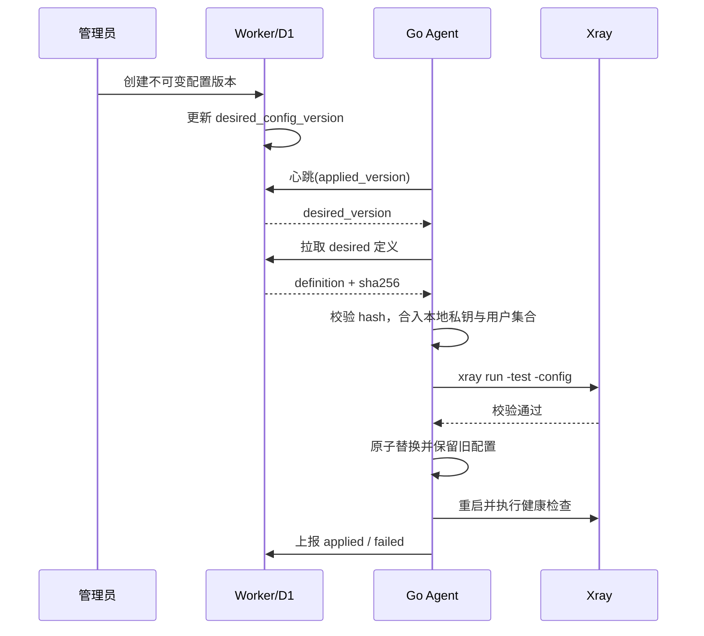

# 配置下发（P2）

Worker 保存不可变的 Xray 静态配置定义，Agent 拉取后合入本地 REALITY 私钥与当前用户集合，校验通过才原子切换。接口见 [api.md](api.md)，`node_configs` 表见 [database.md](database.md)，用户集合同步见 [agent.md](agent.md)。

## 1. 定义与版本

- `definition_json` 描述节点静态配置：日志、DNS、入站协议与公共参数、出站、路由、policy、stats、API inbound。
- 定义不包含 REALITY 私钥与用户凭据；私钥由 Agent 合入，用户由 `users_ver` 同步。
- 用户、额度与授权变化只递增 `users_ver`，不创建配置版本；配置版本只覆盖静态定义。
- `definition_sha256` 为规范化 JSON（键排序、无多余空白）的 SHA-256；版本在节点内严格递增。
- 发布时更新 `nodes.desired_config_version`；Agent 心跳获取 desired，按需拉取。

## 2. 发布流程

## 3. 状态机与回滚

`IDLE → DOWNLOADING → VERIFYING → RENDERING → TESTING → APPLYING → OBSERVING → APPLIED / FAILED`。

- 下载后先验证 Worker definition 的 SHA-256，再合入本地私钥与当前用户集合。
- 新文件与目标文件位于同一文件系统，写临时文件并 fsync 后原子 rename。
- 使用 `xray run -test -config <file>` 校验。
- 保留最近已知可用配置；重启或观察期健康检查失败时恢复并再次启动旧配置。
- 只有 `config/result` 更新权威 applied 状态；心跳中的 applied 值只用于展示，超过 desired 时忽略。
- 相同版本重复应用与重复结果上报保持幂等；迟到的旧版本结果不能覆盖新版本。
- Agent 离线期间只保留最新 desired；恢复后直接追赶最新版本，不逐版本重放。
- 配置 API 只接受结构化定义，不接受 shell 命令。Agent 只执行固定路径的 Xray 校验与重启命令。
