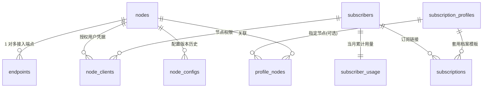

# D1 数据库设计

控制面使用 Cloudflare D1（SQLite），表结构变更以 `migrations/` 目录下的递增 SQL 脚本为准。本篇说明表之间的关系，以及为什么把流量拆成几张表来存。

---

## 1. 通用约定

- **主键**：业务主键统一用 ULID 字符串；`node_clients.xray_email` 固定写成 `u_<ULID>`，不把真实邮箱写进 Xray 配置。
- **时间与数字**：所有时间字段存 Unix 秒整数（列名以 `_at` 结尾）；流量字节数存非负整数；配额和过期时间用 `NULL` 表示“无限制”。
- **软停用**：已有历史流量记录的节点和用户不做物理删除，避免历史账单和统计断层。
- **邮箱规范**：入库前统一转小写并去首尾空格。

---

## 2. 核心实体关系

- **节点与注册**：`nodes` 存节点名称、Token 哈希、心跳周期、最后活跃时间、健康状态、版本号；`node_enrollment_tokens` 存一键部署用的一次性注册令牌哈希与 24 小时过期时间；`endpoints` 存公网地址、端口和协议参数（`params_json`）。
- **用户与凭据**：`subscribers` 存用户状态（`active` / `limited` / `expired` / `disabled`）、月度限额和到期时间；`node_clients` 存用户在某节点上的 `xray_email` 和 `vless_uuid`（取消授权时把 `enabled` 设为 `0`，保留历史统计关联）。
- **订阅与档案**：`subscription_profiles` 存节点筛选策略（全量或指定列表）、`online_only` 开关以及 Clash 模板 JSON；`subscriptions` 存订阅 Token 的 SHA-256 哈希和过期/撤销状态。
- **配置与元数据**：`node_configs` 按 `(node_id, version)` 存不可变配置 JSON 与哈希，回滚时基于旧版本生成递增新版本；`meta` 存全局键值（如 `users_ver`、`default_subscriber_id`）；`audit_events` 记录关键管理操作。

---

## 3. 为什么把流量拆成 5 张表

为了同时满足**写入防重**、**图表快查**和**常数时间判超额**，流量数据按用途拆成了五张表：

| 表名 | 主键 / 粒度 | 干什么用的 |
| --- | --- | --- |
| `traffic_reports` | `(node_id, report_id)` | 存每次上报的凭证和载荷哈希，用来防重放和排查冲突 |
| `node_traffic_hourly` | `(node_id, bucket_start)` | 单节点每小时上下行总量，用于节点详情流量图 |
| `site_traffic_hourly` | `bucket_start` | 全站每小时总量，看全站趋势时只需扫这一张表，不用跨节点聚合 |
| `user_traffic_hourly` | `(subscriber_id, node_id, bucket_start)` | 每个用户在各节点的小时消耗，支撑用户明细与排行 |
| `subscriber_usage` | `subscriber_id` | 每个用户**当前自然月**的累计上下行总量，拉订阅和判超额时直接读这一行 |

---

## 4. 数据保留与自动清理

每天凌晨（Cron `17 3 * * *`）自动分批清理过期数据，单批最多删 **1,000 行**，避免长事务卡死或瞬间打满 D1 每日写入额度：

| 数据 | 保留时间 | 清理依据 |
| --- | --- | --- |
| 小时聚合桶（节点 / 全站 / 用户） | 90 天 | 按 `bucket_start` 清理 |
| 上报收据（`traffic_reports`） | 30 天 | 按 `received_at` 清理 |
| 审计日志（`audit_events`） | 180 天 | 按 `created_at` 清理 |
